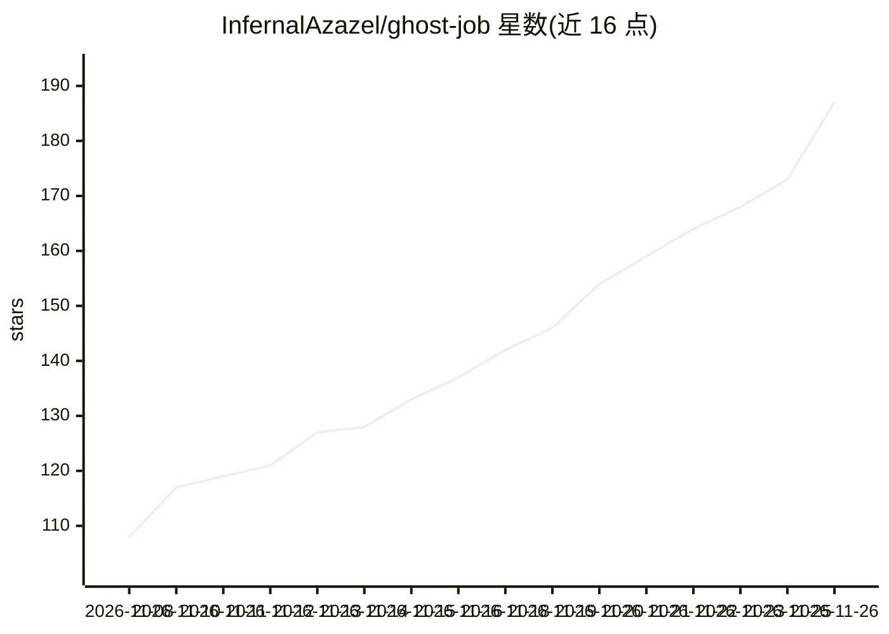

# InfernalAzazel/ghost-job

⭐ 187 · Python · NOASSERTION · 推送 2026-11-25 · [GitHub](https://github.com/InfernalAzazel/ghost-job) · 个人维护 · 中文 README

**求职者用的 BOSS 直聘 AI 自动投递桌面软件**

面向个人求职者的免费桌面应用（Windows/macOS/Linux），通过本机 Chrome 在 BOSS 直聘上自动执行投递流程：按关键词和城市搜索岗位，AI（默认 DeepSeek，可选通义千问/Kimi/智谱/OpenAI/本地 Ollama）阅读职位描述、对比简历打 0-100 匹配分，达标才打招呼；HR 回复后 AI 自动回消息、发简历与作品。另含企业风险查询、求职数据贝叶斯分析、问答库与多账号管理。数据仅存本机，需自备大模型 API Key；源码不开放，仅限个人非商业使用。

## 筛选速览

| 维度 | 判定 | 备注 |
|---|---|---|
| AI 角色 | `ai-native` | 本体是模型或模型工具 |
| 许可风险 | `none` | NOASSERTION |
| 部署形态 | `desktop` | 安装包/桌面程序 |
| 模型依赖 | local-ok | 支持本地模型 |
| 硬件要求 | — | 无带数字的原话,不猜 |
| 安装摩擦 | `low` | 无编译、无系统依赖或容器化 |
| 成熟度 | — | 结构信号不足 |

## 能力要点

- AI 读职位描述并对比简历给出 0-100 匹配度，可按分数过滤投递
- AI 自动回复 HR 消息、发送附件简历与作品，问答库保证事实口径
- 支持 DeepSeek/通义千问/Kimi/智谱/OpenAI 及本地 Ollama（OpenAI 兼容接口）
- 查企业风险（工商信息+负面信息 AI 评估，可出 PDF）与贝叶斯求职数据分析

## 适用场景

- 让程序代替我逐个筛岗位并自动打招呼投递简历
- HR 回复消息时由 AI 按我的简历和问答库自动应答并发简历
- 投递前查公司欠薪、裁员等风险再决定沟通

## 场景标签

`浏览器自动化` · 领域:效率与自动化

## 证据(README 行号)

> L24: Ghost Job 是一款**免费的 BOSS 直聘自动投递桌面软件**，支持 Windows、macOS 和 Linux。它按你设定的岗位关键词和城市自动搜索岗位，用 AI（默认 DeepSeek）阅读职位描述、对比简历打出匹配
> L34: |AI 模型|DeepSeek、通义千问、Kimi、智谱、OpenAI 或本地 Ollama|
> L106: - **简历技术匹配**：上传简历后，AI 对比岗位技术要求与你的技能，给出 0 到 100 分的匹配度

## 星数曲线

2026-11-08 108 → 2026-11-26 187（+79）

---
*卡片 v1 · prompt 1.4 · 生成 2026-11-17 · 置信度 high · 依据 README sha `8609ea5129d1` · [字段定义](../../DATASET.md)*
