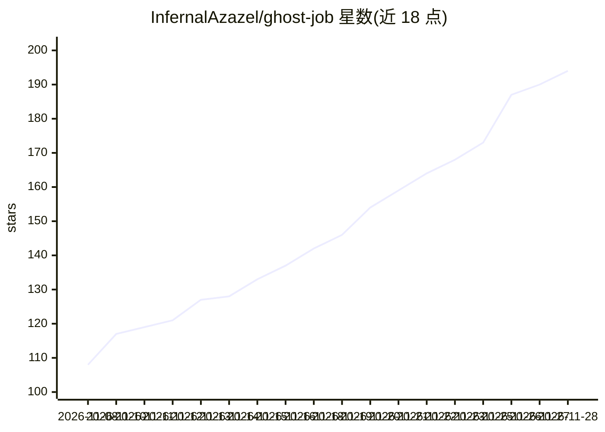

# InfernalAzazel/ghost-job

⭐ 194 · Python · NOASSERTION · 推送 2026-11-26 · [GitHub](https://github.com/InfernalAzazel/ghost-job) · 个人维护 · 中文 README

**给求职者的 BOSS 直聘 AI 自动筛选与投递桌面软件**

面向个人求职者的 BOSS 直聘自动化桌面应用（Windows/macOS/Linux），无需编程。按关键词与城市自动浏览岗位，由大模型（默认 DeepSeek）阅读职位描述、输出 0–100 匹配度并只向达标岗位打招呼；HR 回复后按问答库自动回复、发送简历与作品。内置 Markdown 简历工作台、AI 按项目六项重排改写、AI 生成关键词与求职方向、企业风险查询、贝叶斯求职分析与数据导出。数据全部存本机；通过本机 Chrome 完成投递；源码不公开，禁止商业用途。

## 筛选速览

| 维度 | 判定 | 备注 |
|---|---|---|
| AI 角色 | `ai-native` | 本体是模型或模型工具 |
| 许可风险 | `none` | NOASSERTION |
| 部署形态 | `desktop` | 安装包/桌面程序 |
| 模型依赖 | local-ok | 支持本地模型 |
| 硬件要求 | — | 无带数字的原话,不猜 |
| 安装摩擦 | `low` | 无编译、无系统依赖或容器化 |
| 成熟度 | — | 结构信号不足 |

## 能力要点

- AI 岗位筛选与 0–100 匹配度打分，支持匹配度阈值过滤
- AI 自动回复 HR、按问答库口径回答、自动发送简历与作品
- Markdown 简历工作台：5 套模板、A4 实时预览、AI 按六项结构改写并导出 PDF
- 支持 DeepSeek、通义千问、Kimi、智谱、OpenAI 及本地 Ollama

## 适用场景

- 按求职方向自动筛选并投递 BOSS 直聘岗位
- 让 AI 按我的口径自动回复 HR 消息和发送简历
- 在软件里写简历、AI 改写并导出 PDF
- 复盘投递漏斗数据并让 AI 解读下一步策略

## 场景标签

`浏览器自动化` `AI 写作` `数据分析` · 领域:效率与自动化

## 证据(README 行号)

> L24: Ghost Job 是一款**免费的 BOSS 直聘自动投递桌面软件**，支持 Windows、macOS 和 Linux。它按你设定的岗位关键词和城市自动搜索岗位，用 AI（默认 DeepSeek）阅读职位描述、按求职方向打出岗
> L34: |AI 模型|DeepSeek、通义千问、Kimi、智谱、OpenAI 或本地 Ollama|
> L139: 2. 安装 Google Chrome（自动投递通过本机 Chrome 完成）

## 星数曲线

2026-11-08 108 → 2026-11-28 194（+86）

---
*卡片 v1 · prompt 1.4 · 生成 2026-11-27 · 置信度 high · 依据 README sha `681116b83bc6` · [字段定义](../../DATASET.md)*
