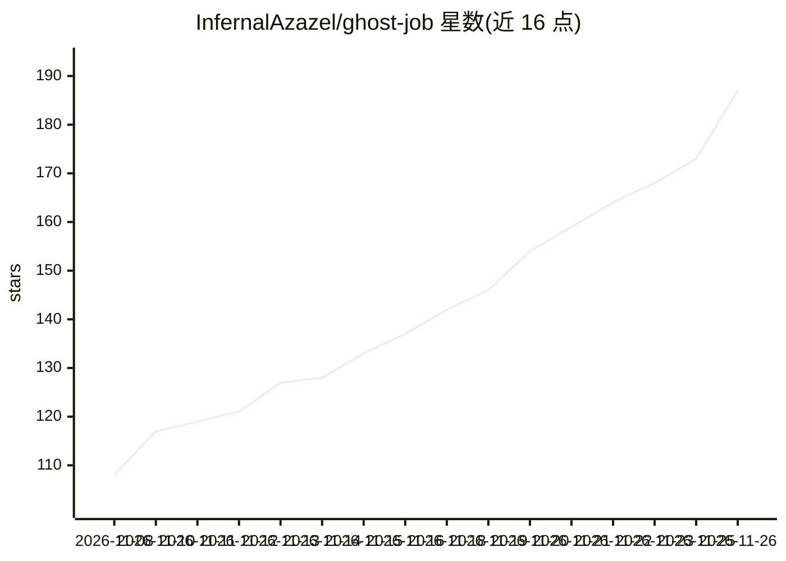

# InfernalAzazel/ghost-job

⭐ 187 · Python · NOASSERTION · 推送 2026-11-25 · [GitHub](https://github.com/InfernalAzazel/ghost-job) · 个人维护 · 中文 README

**给求职者的 BOSS 直聘自动投递桌面软件，AI 筛岗代聊**

面向 BOSS 直聘的自动投递桌面应用，覆盖 Windows/macOS/Linux，无需编程。按用户设定的关键词与城市自动搜索岗位，用大模型（默认 DeepSeek）阅读职位描述并打 0–100 匹配分，仅向匹配岗位打招呼；HR 回复后按问答库自动回复、发送简历与作品。含多账号、企业风险查询、贝叶斯求职分析、JSON 导出与自动更新。数据全部存本机；源码不公开，仅供个人非商业使用，依赖本机 Chrome 完成投递。

## 筛选速览

| 维度 | 判定 | 备注 |
|---|---|---|
| AI 角色 | `ai-native` | 本体是模型或模型工具 |
| 许可风险 | `none` | NOASSERTION |
| 部署形态 | `desktop` | 安装包/桌面程序 |
| 模型依赖 | local-ok | 支持本地模型 |
| 硬件要求 | — | 无带数字的原话,不猜 |
| 安装摩擦 | `low` | 无编译、无系统依赖或容器化 |
| 成熟度 | — | 结构信号不足 |

## 能力要点

- AI 岗位筛选与匹配度打分，低于阈值不投
- HR 消息自动回复，问答库约束口径，自动发简历与作品
- 查企业：工商信息+负面搜索+AI 风险评估出 PDF 报告
- 支持 DeepSeek/通义千问/Kimi/智谱/OpenAI 兼容服务或本地 Ollama

## 适用场景

- 按求职方向自动筛选并投递 BOSS 直聘岗位
- 让 AI 代回 HR 消息、自动发送简历和作品
- 投递前查询目标公司的欠薪裁员风险

## 场景标签

`浏览器自动化` `工作流自动化` · 领域:效率与自动化

## 证据(README 行号)

> L24: Ghost Job 是一款**免费的 BOSS 直聘自动投递桌面软件**，支持 Windows、macOS 和 Linux。它按你设定的岗位关键词和城市自动搜索岗位，用 AI（默认 DeepSeek）阅读职位描述、按求职方向打出岗
> L34: |AI 模型|DeepSeek、通义千问、Kimi、智谱、OpenAI 或本地 Ollama|

## 星数曲线

2026-11-08 108 → 2026-11-26 187（+79）

---
*卡片 v1 · prompt 1.4 · 生成 2026-11-26 · 置信度 high · 依据 README sha `ce43efe59fc4` · [字段定义](../../DATASET.md)*
