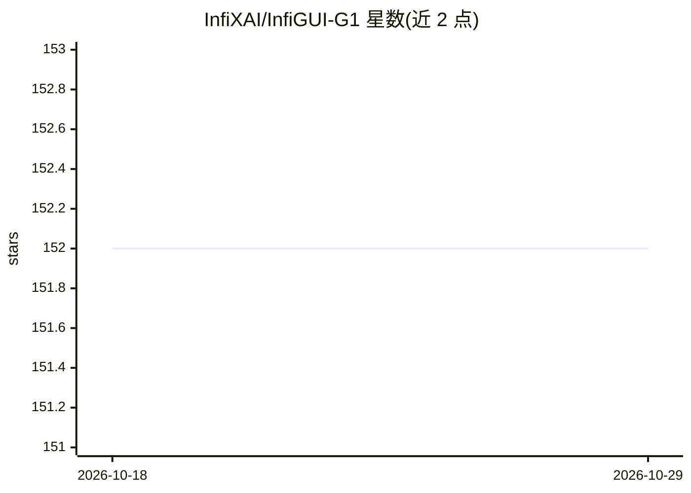

# InfiXAI/InfiGUI-G1

⭐ 152 · Python · Apache-2.0 · 推送 2025-11-19 · [GitHub](https://github.com/InfiXAI/InfiGUI-G1) · [官网](https://arxiv.org/abs/2508.05731) · 组织维护

**GUI 定位模型系列：用自适应探索策略优化训练的 3B/7B 多模态模型**

AAAI 2026 Oral 论文 InfiGUI-G1 的官方仓库，提供 3B 与 7B 两个在 Hugging Face 公开的 GUI grounding 模型及训练与评测代码。方法为自适应探索策略优化（AEPO）：多答案生成在单次前向中探索候选动作，配合由效率原则导出的自适应探索奖励（AER）平衡探索与利用。评测基于 vLLM 推理库，支持 ScreenSpot-Pro、ScreenSpot-V2、UI-Vision、MMBench-GUI、UI-I2E-Bench 五个基准；训练基于 VERL 框架，论文结果在 4×H800 GPU 上获得。

## 筛选速览

| 维度 | 判定 | 备注 |
|---|---|---|
| AI 角色 | `ai-native` | 本体是模型或模型工具 |
| 许可风险 | `permissive` | Apache-2.0 |
| 部署形态 | `None` |  |
| 模型依赖 | local-ok | 支持本地模型 |
| 硬件要求 | — | 无带数字的原话,不猜 |
| 安装摩擦 | `medium` | 含编译或系统依赖之一 |
| 成熟度 | — | 结构信号不足 |

## 能力要点

- AEPO 训练框架：多答案生成 + 自适应探索奖励（AER）
- 3B 与 7B 模型已在 Hugging Face 公开
- 提供评测脚本（5 个 GUI grounding 基准）与训练脚本
- 评测基于 vLLM，训练基于 VERL

## 适用场景

- 复现论文在 GUI grounding 基准上的评测结果
- 下载模型用于界面元素定位任务
- 基于 VERL 复现或改进 AEPO 训练流程

## 场景标签

`GUI 自动化` `强化学习` `模型评测` · 领域:效率与自动化

## 证据(README 行号)

> L20: To address this critical exploration problem, we introduce **InfiGUI-G1**, a series of models trained with **Adapti
> L37: - 🚀 ***`2025/08/11`*** The models InfiGUI-G1-3B and InfiGUI-G1-7B are now publicly available on Hugging Face.

## 星数曲线

2026-10-18 152 → 2026-10-29 152（+0）

---
*卡片 v1 · prompt 1.4 · 生成 2026-10-22 · 置信度 high · 依据 README sha `65d4de1e1daa` · [字段定义](../../DATASET.md)*
