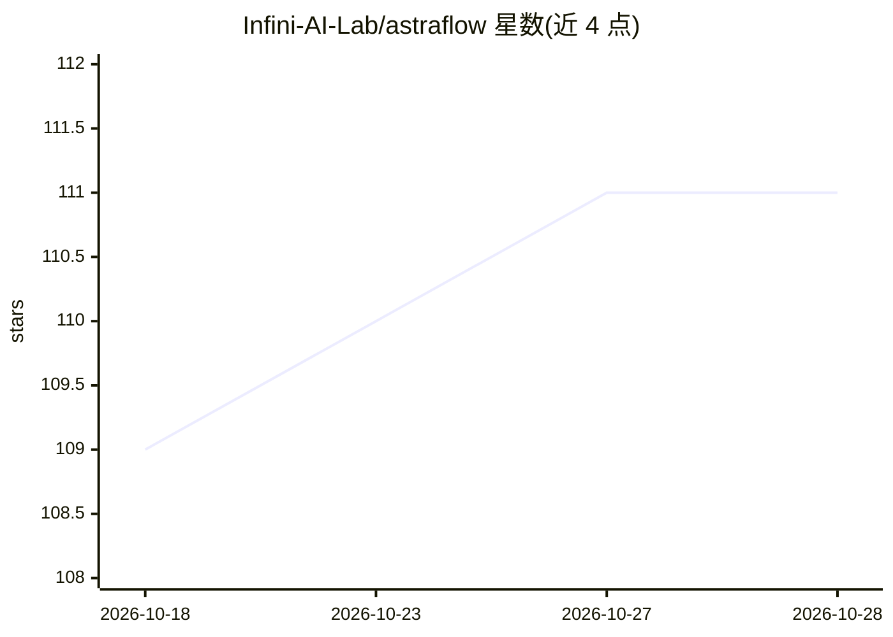

# Infini-AI-Lab/astraflow

⭐ 111 · Python · Apache-2.0 · 推送 2026-07-26 · [GitHub](https://github.com/Infini-AI-Lab/astraflow) · [官网](https://infini-ai-lab.github.io/astraflow/docs/) · 组织维护

**面向（多）智能体 LLM 的数据流式强化学习训练系统**

AstraFlow 是一个以数据流（dataflow）为核心设计的 LLM 强化学习训练系统，面向开展 RL 训练的研究者与工程师。原生支持全异步多策略协同 RL、弹性跨区域异构 rollout、可替换的 rollout 与训练服务、可组合数据算法。提供数学推理、代码生成、搜索增强、ALFWorld/WebShop 智能体等 8 类训练配方，支持 Qwen3 系列模型与 Megatron 权重同步后端，发布 Docker 镜像（transformers/SGLang 栈，已在 8×H100 上端到端验证）。

## 筛选速览

| 维度 | 判定 | 备注 |
|---|---|---|
| AI 角色 | `ai-ecosystem` | LLM/agent 周边工具 |
| 许可风险 | `permissive` | Apache-2.0 |
| 部署形态 | `None` |  |
| 模型依赖 | — | README 未给出锁定关系 |
| 硬件要求 | — | 无带数字的原话,不猜 |
| 安装摩擦 | `medium` | 含编译或系统依赖之一 |
| 成熟度 | — | 结构信号不足 |

## 能力要点

- 全异步多策略协同 RL 训练，各策略独立训练器与数据/权重流
- 弹性异构跨区域 rollout 池与可替换 rollout/trainer 服务
- 8 类训练配方：数学、代码、搜索、ALFWorld、WebShop 及多智能体变体
- v0.1.2 Docker 镜像：transformers 5.8 / SGLang 0.5.13 栈，8×H100 端到端验证

## 适用场景

- 对 LLM/智能体做 RLVR 数学与代码推理训练
- 多策略协同训练与多智能体（actor+verifier）工作流
- 构建弹性异构 rollout 基础设施做大规模 RL 实验

## 场景标签

`强化学习` · 领域:训练与推理

## 证据(README 行号)

> L10: AstraFlow is a **dataflow-oriented** reinforcement learning system designed for better flexibility and scalability.
> L12: AstraFlow **natively** supports the following for LLM RL training **without any feature-specific system engineering
> L40: |`math/`|RLVR math reasoning — Qwen3-1.7B / 8B, M2PO, full and delta-weight transfer|

## 星数曲线

2026-10-18 109 → 2026-10-28 111（+2）

---
*卡片 v1 · prompt 1.4 · 生成 2026-10-23 · 置信度 high · 依据 README sha `61b6216ea1c6` · [字段定义](../../DATASET.md)*
