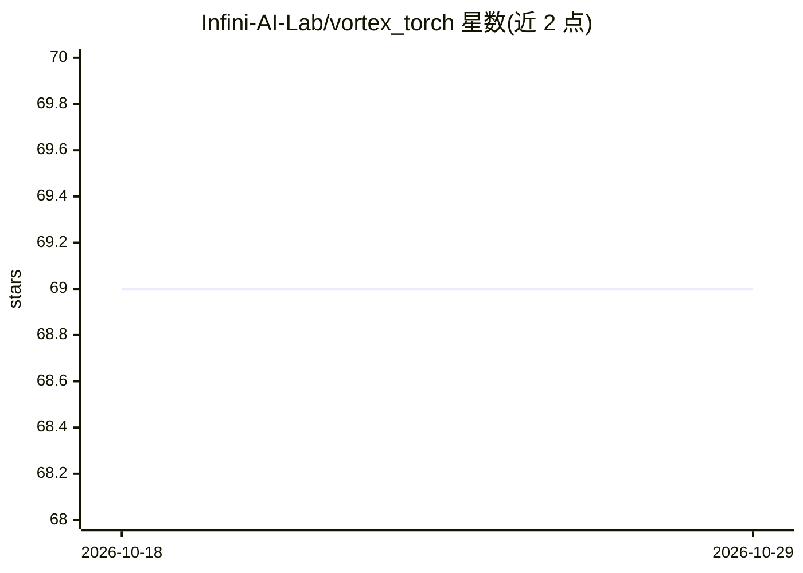

# Infini-AI-Lab/vortex_torch

⭐ 69 · Python · Apache-2.0 · 推送 2026-08-22 · [GitHub](https://github.com/Infini-AI-Lab/vortex_torch) · [官网](https://infini-ai-lab.github.io/vortex_torch/) · 组织维护

**面向 AI Agent 的可编程稀疏注意力算法设计与评测框架**

基于 PyTorch 风格前端与页级张量抽象的稀疏注意力编程框架，后端集成 SGLang 推理栈与 FlashInfer/CUDA Graph/Radix Attention。用户以 vFlow 子类定义稀疏注意力算法，经注册后由 SGLang 引擎加载运行；AI agent 可端到端生成、编译、基准测试并迭代算法，内置 Claude Code 工作区（/innovate、/iterate 等命令）与 OpenHands 演示。限制：部分算子尚未融合优化，可能增加内存占用导致 CUDA OOM。面向稀疏注意力研究与大模型推理优化场景。

## 筛选速览

| 维度 | 判定 | 备注 |
|---|---|---|
| AI 角色 | `ai-ecosystem` | LLM/agent 周边工具 |
| 许可风险 | `permissive` | Apache-2.0 |
| 部署形态 | `None` |  |
| 模型依赖 | — | README 未给出锁定关系 |
| 硬件要求 | — | 无带数字的原话,不猜 |
| 安装摩擦 | `medium` | 含编译或系统依赖之一 |
| 成熟度 | `idea` | |

## 能力要点

- PyTorch 风格 vFlow 前端定义稀疏注意力算法，无需处理 batching/缓存/分页注意力
- 后端集成 SGLang，配合 FlashInfer/CUDA Graph/Radix Attention 运行
- 内置 Claude Code 工作区（/innovate、/iterate 斜杠命令）支持自主算法迭代与 Pareto 前沿映射
- schedule_policy 允许以 CUDA C++ 代码片段自定义每序列页预算

## 适用场景

- 研究人员快速实现并部署新的稀疏注意力算法
- 让 AI agent 自主生成、基准测试并迭代稀疏注意力算法
- 在超长生成与大参数模型上实验稀疏注意力加速

## 场景标签

`模型评测` · 领域:评测与运维

## 证据(README 行号)

> L15: Vortex couples a **Python-embedded frontend** over a **page-centric tensor abstraction** — concise enough to expres
> L36: - **Agent Native**

## 星数曲线

2026-10-18 69 → 2026-10-29 69（+0）

---
*卡片 v1 · prompt 1.4 · 生成 2026-10-24 · 置信度 high · 依据 README sha `779a2334de83` · [字段定义](../../DATASET.md)*
