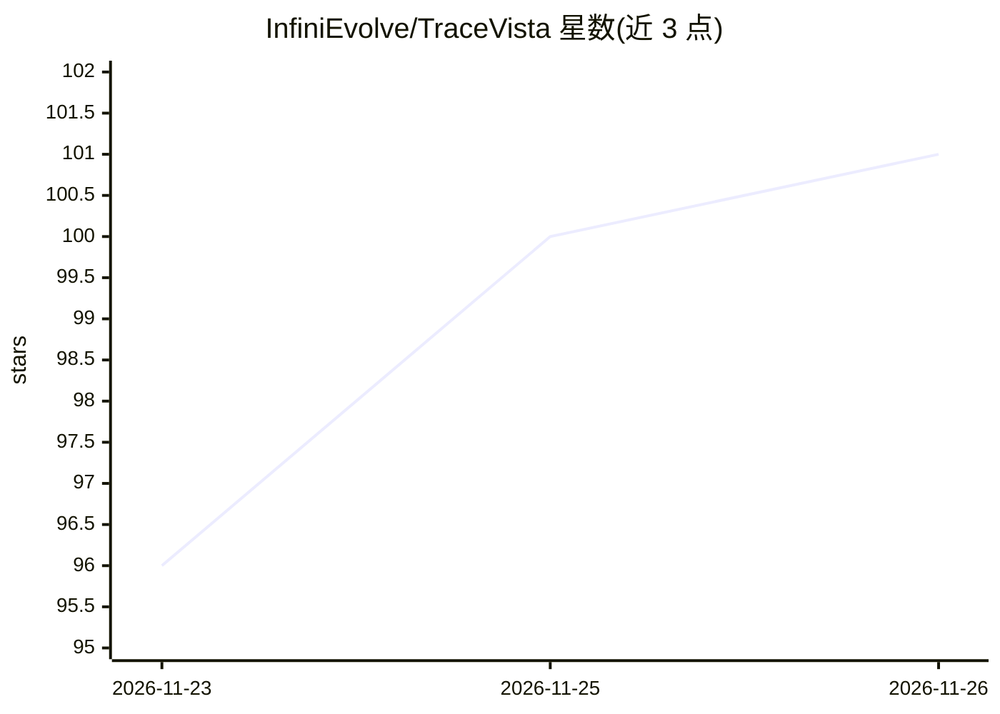

# InfiniEvolve/TraceVista

⭐ 101 · JavaScript · MIT · 推送 2026-11-23 · [GitHub](https://github.com/InfiniEvolve/TraceVista) · [官网](https://tracevista.pages.dev/) · 个人维护 · 中文 README

**给开发者把 agent 日志转成可交互决策地图与故事的可视化工具**

TraceVista 将 agent 会话日志（如 Claude Code、Codex、Pi 的 session log）转换为 .agent-state.json，并生成交互式离线查看器：四层视图（系统状态→工作阶段→动作→原始记录）、版本树与执行顺序切换、Play 引导式回放，以及带可点击引用的上下文问答。本地 CLI 提供 build/query/inspect 等检索命令且不调用模型；问答需自行接入模型端点。查看器部分无需注册或模型 key 即可浏览示例。

## 筛选速览

| 维度 | 判定 | 备注 |
|---|---|---|
| AI 角色 | `ai-ecosystem` | LLM/agent 周边工具 |
| 许可风险 | `permissive` | MIT |
| 部署形态 | `library` | 以包/库形式分发 |
| 模型依赖 | local-ok | 支持本地模型 |
| 硬件要求 | — | 无带数字的原话,不猜 |
| 安装摩擦 | `low` | 无编译、无系统依赖或容器化 |
| 成熟度 | — | 结构信号不足 |

## 能力要点

- 四层下钻视图：系统状态、工作阶段、动作、原始记录
- 上下文问答带可点击引用，可回链到原始证据
- 本地 CLI 检索命令（query/inspect）不产生模型调用
- 保留原始记录原文，摘要与证据并列可核对

## 适用场景

- 审阅 coding agent 通宵运行后的决策路径与代码改动
- 向同事分享并共同查看一段 agent 会话轨迹
- 在上下文问答中追问某次决策为何被放弃

## 场景标签

`LLM 可观测性` · 领域:评测与运维

## 证据(README 行号)

> L60: **Install → invoke → browse → query.** The local CLI packages the same conversion
> L114: Works with **Claude Code, Codex, and Pi** session logs, **InferenceBench** traces, and **SWE-rebench OpenHands** t
> L159: Connect Claude, OpenAI, Gemini, DeepSeek, Kimi, GLM, Qwen, MiniMax, OpenRouter, or your own compatible endpoint. L

## 星数曲线

2026-11-23 96 → 2026-11-26 101（+5）

---
*卡片 v1 · prompt 1.4 · 生成 2026-11-23 · 置信度 high · 依据 README sha `b63e2d5a233a` · [字段定义](../../DATASET.md)*
