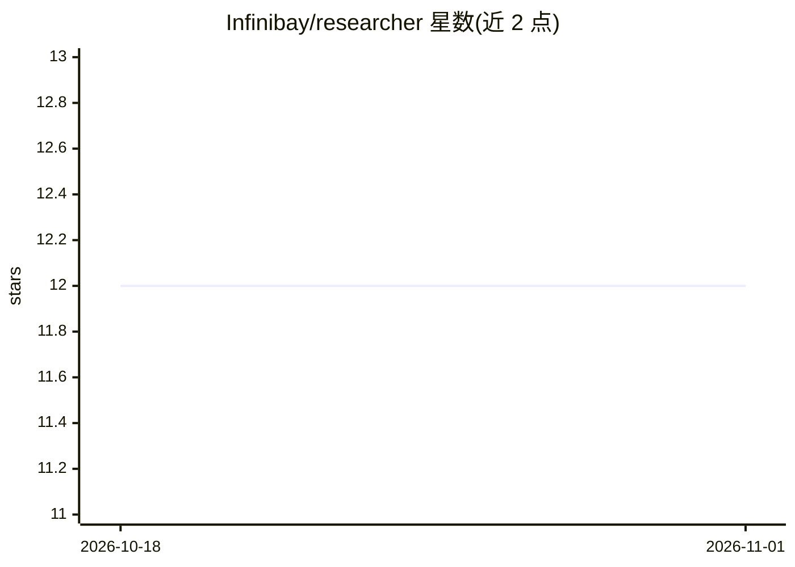

# Infinibay/researcher

⭐ 12 · Python · NOASSERTION · 推送 2026-03-30 · [GitHub](https://github.com/Infinibay/researcher) · 个人维护

**面向消费级硬件的多智能体协作研究/开发原型系统**

原型多智能体 swarm 系统：team lead 规划、researchers 收集信息、developers 写代码、reviewers 检查质量，通过事件驱动 flows 实时编排，运行于 14B 及以下小模型与消费级硬件。每个 agent 的工具在 Podman/Docker 隔离 pod 中执行，支持 GPU 直通。需 Python 3.12+、Node.js 20+、Podman/Docker、Ollama；README 以 start.sh 一键启动，并列出已知问题（Stop 按钮失效、工具偶发重复执行）。

## 筛选速览

| 维度 | 判定 | 备注 |
|---|---|---|
| AI 角色 | `ai-native` | 本体是模型或模型工具 |
| 许可风险 | `none` | NOASSERTION |
| 部署形态 | `None` |  |
| 模型依赖 | local-ok | 支持本地模型 |
| 硬件要求 | `gpu-8g` | |
| 安装摩擦 | `low` | 无编译、无系统依赖或容器化 |
| 成熟度 | `idea` | |

## 能力要点

- 事件驱动的多智能体协作（规划/研究/开发/审查角色分工）
- 面向 14B 及以下小模型与消费级硬件设计
- Podman/Docker 隔离沙箱，agent 工具在容器内执行
- README 列出 5 个已测试小模型及云端 API 使用说明

## 适用场景

- 在本地小模型上跑自主研究与信息调查任务
- 让 agent 团队协作完成软件开发与代码审查
- 验证小参数量模型的多智能体编排可行性

## 场景标签

`多智能体` `Agent 框架` · 领域:Agent 开发

## 证据(README 行号)

> L3: A prototype multi-agent swarm system for autonomous research, investigation, and software development — designed to 
> L5: Agents collaborate through an event-driven architecture: a team lead plans work, researchers gather information, dev
> L12: - **Ollama** (for local LLM inference)

## 星数曲线

2026-10-18 12 → 2026-11-01 12（+0）

---
*卡片 v1 · prompt 1.4 · 生成 2026-11-01 · 置信度 high · 依据 README sha `7edfed54e98a` · [字段定义](../../DATASET.md)*
