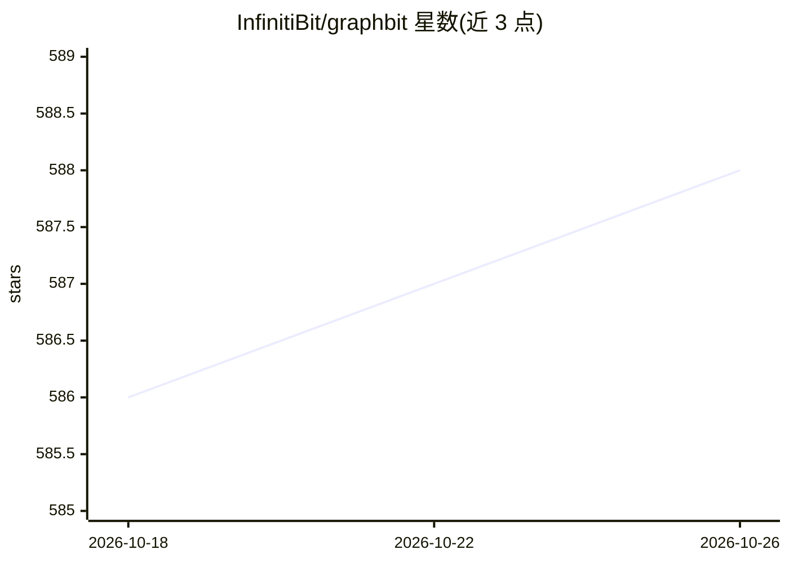

# InfinitiBit/graphbit

⭐ 588 · Rust · Apache-2.0 · 推送 2026-06-22 · [GitHub](https://github.com/InfinitiBit/graphbit) · [官网](https://graphbit.ai) · 组织维护

**Rust 核心、Python 接口的多智能体 LLM 编排框架**

由 InfinitiBit（慕尼黑）开发的开源 agentic AI 框架：Rust 核心承载工作流引擎、agent 与 LLM provider，经 PyO3 绑定提供异步 Python API。支持多智能体并行执行、步骤间记忆持久化、故障自恢复、类型安全执行层，内置断路器与重试策略、追踪与结构化日志。LLM 接入覆盖 OpenAI、Anthropic、Azure、DeepSeek、Ollama 等多家，另有向量库、数据库、文档加载器等社区扩展。README 含内部基准数据（自称 CPU/内存占用低于其他 Python 框架），Grant Thornton 德国为生产用户。Apache 2.0 许可。

## 筛选速览

| 维度 | 判定 | 备注 |
|---|---|---|
| AI 角色 | `ai-ecosystem` | LLM/agent 周边工具 |
| 许可风险 | `permissive` | Apache-2.0 |
| 部署形态 | `library` | 以包/库形式分发 |
| 模型依赖 | local-ok | 支持本地模型 |
| 硬件要求 | — | 无带数字的原话,不猜 |
| 安装摩擦 | `low` | 无编译、无系统依赖或容器化 |
| 成熟度 | — | 结构信号不足 |

## 能力要点

- Rust 核心工作流引擎 + PyO3 异步 Python 绑定的三层架构
- 多智能体并行工作流：记忆持久化、故障自恢复、断路器与重试
- 多 LLM provider 接入（OpenAI、Anthropic、Azure、DeepSeek、Ollama、OpenRouter 等）
- 内置 Tracer 追踪 LLM 调用、token 用量、延迟与错误

## 适用场景

- 构建生产环境的多智能体工作流
- 需要类型安全与可复现输出的 agent 编排
- 资源受限环境下运行 LLM 应用并控制 CPU/内存开销

## 场景标签

`多智能体` `Agent 框架` · 领域:Agent 开发

## 证据(README 行号)

> L33: GraphBit is an open-source agentic AI framework for deterministic, concurrent, low-overhead execution.
> L130: from graphbit import LlmConfig, Executor, Workflow, Node, tool, GuardRailPolicyConfig
> L155: - **Rust Core** - Workflow engine, agents, and LLM providers

## 星数曲线

2026-10-18 586 → 2026-10-26 588（+2）

---
*卡片 v1 · prompt 1.4 · 生成 2026-10-21 · 置信度 high · 依据 README sha `ab21782f9dcf` · [字段定义](../../DATASET.md)*
