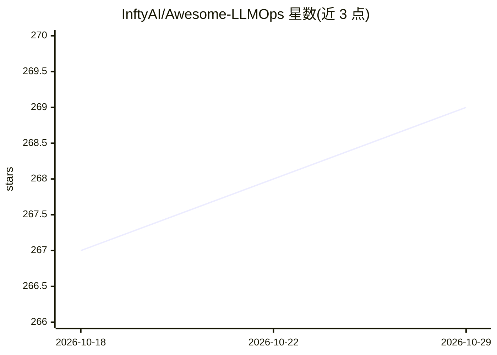

# InftyAI/Awesome-LLMOps

⭐ 269 · Python · Apache-2.0 · 推送 2026-10-28 · [GitHub](https://github.com/InftyAI/Awesome-LLMOps) · [官网](https://awesome-llmops.inftyai.com) · 组织维护

**LLMOps 工具精选清单：按推理/路由/网关等分类收录**

由 InftyAI 维护的 LLMOps 工具策展清单，按目录组织为推理（推理引擎、推理平台、中间件、LLM 路由、AI 网关、结构化输出、模拟器、基准测试）与编排（应用框架等）等大类，收录 vLLM、Ollama、LiteLLM、Kong 等条目，每条附 Stars/贡献者/最近提交等元数据。面向为 LLM 应用选型与搭建基础设施的开发者与团队，通过提交 issue 增补新项目。本身为清单仓库，不提供可运行组件。

## 筛选速览

| 维度 | 判定 | 备注 |
|---|---|---|
| AI 角色 | `ai-knowledge` | 知识聚合/清单类 |
| 许可风险 | `permissive` | Apache-2.0 |
| 部署形态 | `None` |  |
| 模型依赖 | — | README 未给出锁定关系 |
| 硬件要求 | — | 无带数字的原话,不猜 |
| 安装摩擦 | `low` | 无编译、无系统依赖或容器化 |
| 成熟度 | — | 结构信号不足 |

## 能力要点

- 按推理引擎/平台/中间件/路由/网关等目录分层组织
- 覆盖推理、KV Cache 中间件、LLM 路由与基准测试工具
- 条目附 Stars、贡献者、最近提交等元数据
- 通过 issue 开放增补新项目

## 适用场景

- 为 LLM 推理与服务选型查找候选工具
- 了解 LLMOps 工具生态的类别覆盖
- 对比 LLM 网关与路由类项目

## 场景标签

`精选清单` · 领域:学习与行业

## 证据(README 行号)

> L1: # Awesome-LLMOps Awesome
> L3: 🎉 An awesome &amp; curated list of best LLMOps tools.

## 星数曲线

2026-10-18 267 → 2026-10-29 269（+2）

---
*卡片 v1 · prompt 1.4 · 生成 2026-10-22 · 置信度 high · 依据 README sha `670c52234c38` · [字段定义](../../DATASET.md)*
