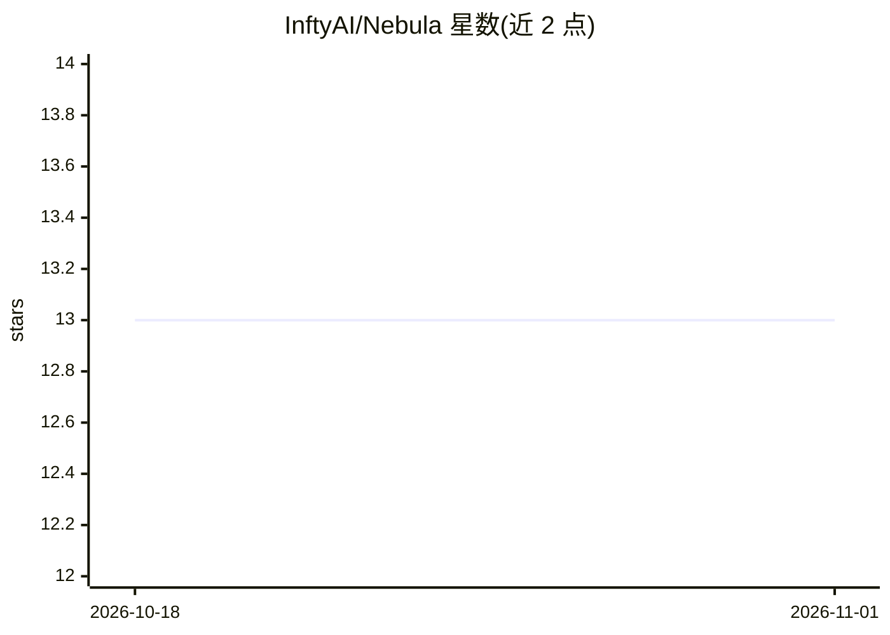

# InftyAI/Nebula

⭐ 13 · Go · Apache-2.0 · 推送 2026-10-19 · [GitHub](https://github.com/InftyAI/Nebula) · 组织维护

**GPUaaS 控制平面：跨 NeoCloud/超大规模云统一供给 GPU Pod**

Kubernetes operator 形式的 GPU 容量控制平面：通过 NodePool/NodeClaim 两级 API（Karpenter 风格）把外部 GPU 云（Modal、RunPod、AWS）的容量转化为普通 Pod 可调度的虚拟节点。工作负载以标签接入后，由 mutating webhook 注入调度门、placement 控制器按成本/可用性选厂商，per-provider 虚拟 kubelet 拉起真实实例，NodeClaim 用 finalizer 保证回收。面向在多云环境运行 GPU 工作负载的平台/集群运维开发者。

## 筛选速览

| 维度 | 判定 | 备注 |
|---|---|---|
| AI 角色 | `ai-ecosystem` | LLM/agent 周边工具 |
| 许可风险 | `permissive` | Apache-2.0 |
| 部署形态 | `None` |  |
| 模型依赖 | — | README 未给出锁定关系 |
| 硬件要求 | — | 无带数字的原话,不猜 |
| 安装摩擦 | `low` | 无编译、无系统依赖或容器化 |
| 成熟度 | — | 结构信号不足 |

## 能力要点

- NodePool/NodeClaim Karpenter 风格 API，跨厂商单池 failover
- 支持 Modal、RunPod、AWS 三家 GPU 云供给
- 按成本/可用性/区域的策略化调度与网络出口策略
- per-instance 成本追踪与调度/供给/生命周期指标日志

## 适用场景

- 让现有 Deployment/Job 加标签即可用上外部 GPU 云
- 按成本和可用性在多家 GPU 云之间选厂商并 failover
- 跟踪每个 GPU 实例的开支并保证实例回收不泄漏

## 场景标签

 · 领域:云计算/Kubernetes 基础设施

## 证据(README 行号)

> L10: Run GPU workloads on any NeoCloud or hyperscaler or your own infrastructure through one Kubernetes API.
> L26: - **Multi-provider support.** Modal, RunPod and AWS today, with more providers coming soon.

## 星数曲线

2026-10-18 13 → 2026-11-01 13（+0）

---
*卡片 v1 · prompt 1.4 · 生成 2026-10-31 · 置信度 high · 依据 README sha `1e4f444b9016` · [字段定义](../../DATASET.md)*
