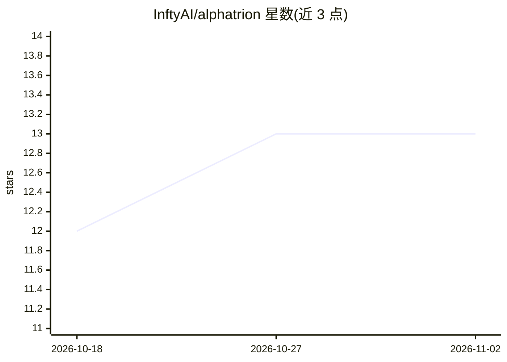

# InftyAI/alphatrion

⭐ 13 · Python · Apache-2.0 · 推送 2026-10-25 · [GitHub](https://github.com/InftyAI/alphatrion) · 组织维护

**开源递归自我改进（RSI）系统的构建项目：含实验跟踪框架**

InftyAI 维护的开源项目，目标是构建递归自我改进（RSI）的 AI 系统：把每次尝试作为实验进行运行、测量、版本化与追踪。包含两个组件：Framework（Beta），提供实验与运行管理、artifact 注册表、指标、分布式追踪和 dashboard，可独立用于任意 LLM 应用；Swarm（Early development），基于框架的 RSI 系统。通过 pip 安装，Apache-2.0 许可。

## 筛选速览

| 维度 | 判定 | 备注 |
|---|---|---|
| AI 角色 | `ai-ecosystem` | LLM/agent 周边工具 |
| 许可风险 | `permissive` | Apache-2.0 |
| 部署形态 | `library` | 以包/库形式分发 |
| 模型依赖 | — | README 未给出锁定关系 |
| 硬件要求 | — | 无带数字的原话,不猜 |
| 安装摩擦 | `low` | 无编译、无系统依赖或容器化 |
| 成熟度 | `idea` | |

## 能力要点

- Framework 提供实验/运行跟踪、artifact 注册表、指标与分布式追踪、dashboard
- Framework 声明可独立复用于任意 LLM 应用
- Swarm 组件实现递归自我改进（声明为早期开发阶段）

## 适用场景

- 为 LLM 应用做实验跟踪、指标与分布式追踪
- 复用框架搭建自己的 LLM 实验基础设施
- 参与递归自我改进系统的实验与开发

## 场景标签

`LLM 可观测性` `多智能体` · 领域:Agent 开发

## 证据(README 行号)

> L15: **AlphaTrion** is an open-source project to build **recursive self-improvement (RSI)**: AI systems that get better 
> L21: |Framework|Beta|The infrastructure for running and tracking experiments: experiments and runs, an artifact registry

## 星数曲线

2026-10-18 12 → 2026-11-02 13（+1）

---
*卡片 v1 · prompt 1.4 · 生成 2026-10-31 · 置信度 high · 依据 README sha `21fa3433a93c` · [字段定义](../../DATASET.md)*
