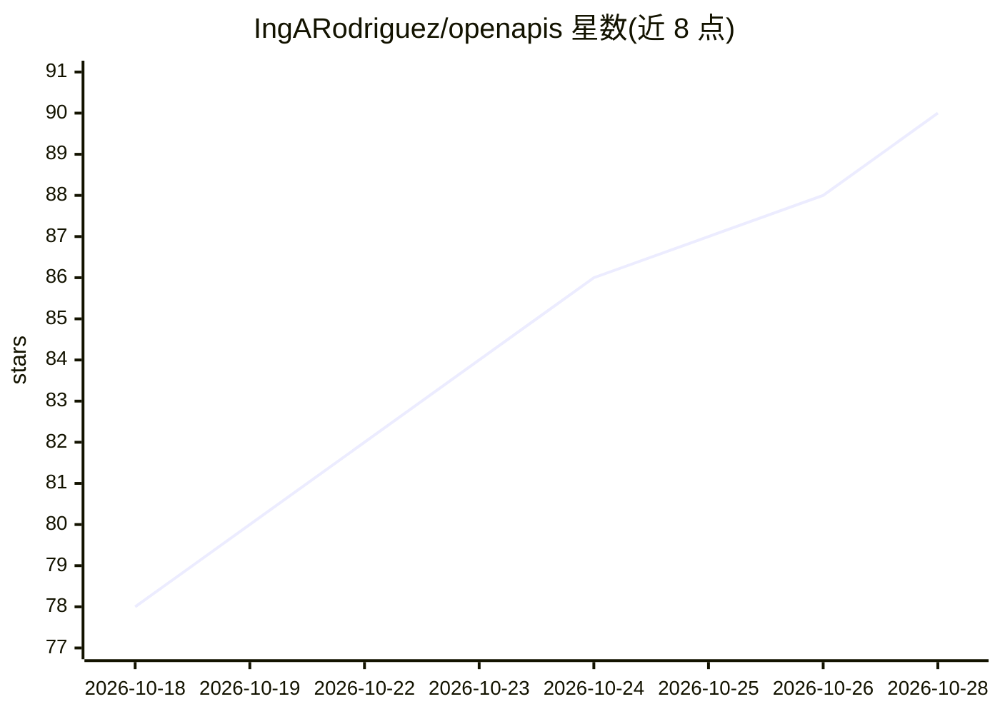

# IngARodriguez/openapis

⭐ 90 · MIT · 推送 2026-06-02 · [GitHub](https://github.com/IngARodriguez/openapis) · [官网](https://openapis.online/) · 个人维护

**统一代理：免费转发 OpenAI 与 Anthropic API（托管服务）**

OpenAPIs 是一个托管代理服务（hosted proxy），在同一 URL 下提供 OpenAI 兼容与 Anthropic 兼容两个端点，宣称覆盖 100+ 文本/推理模型（GPT-5 系列、Claude 3.x–4.x），图像/视频/音频模型被排除。用户只需改写 base_url 与 API key 即可让官方 SDK、Claude Code、OpenCode 等现有客户端继续工作。当前处于开放测试期，宣称完全免费、共享测试密钥、无速率限制；README 明确其代理背后的服务为专有软件，仓库本身（落地页与示例）为 MIT。

## 筛选速览

| 维度 | 判定 | 备注 |
|---|---|---|
| AI 角色 | `ai-ecosystem` | LLM/agent 周边工具 |
| 许可风险 | `permissive` | MIT |
| 部署形态 | `None` |  |
| 模型依赖 | locked-api |  |
| 硬件要求 | — | 无带数字的原话,不猜 |
| 安装摩擦 | `low` | 无编译、无系统依赖或容器化 |
| 成熟度 | `idea` | |

## 能力要点

- 同一 URL 提供 OpenAI 与 Anthropic 两种兼容端点
- 官方 SDK 仅需改 base_url 即可继续使用
- 两端口径下均支持端到端原生 SSE 流式输出
- 宣称覆盖 100+ 文本/推理模型（GPT-5 家族与 Claude 3.x–4.x）

## 适用场景

- 让 Claude Code、OpenCode 等工具免 Anthropic 计费密钥即可调用
- 已有 OpenAI/Anthropic SDK 代码切换到统一代理端点
- 多客户端（IDE、SDK、路由器）共用单一 API 入口

## 场景标签

`模型网关` · 领域:Agent 开发

## 证据(README 行号)

> L24: **OpenAPIs** is a unified proxy to **OpenAI** and **Anthropic**. Drop-in compatible with their official SDKs — just
> L182: OpenRouter aggregates many providers behind a unified billing page; LiteLLM is a Python library you self-host; `cl

## 星数曲线

2026-10-18 78 → 2026-10-28 90（+12）

---
*卡片 v1 · prompt 1.4 · 生成 2026-10-24 · 置信度 high · 依据 README sha `7198ddaacee1` · [字段定义](../../DATASET.md)*
