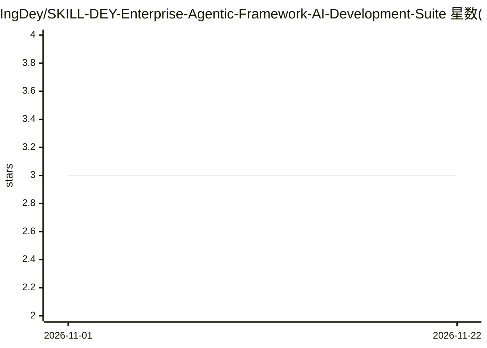

# IngDey/SKILL-DEY-Enterprise-Agentic-Framework-AI-Development-Suite

⭐ 3 · TypeScript · MIT · 推送 2026-11-12 · [GitHub](https://github.com/IngDey/SKILL-DEY-Enterprise-Agentic-Framework-AI-Development-Suite) · 个人维护

**为 AI 辅助开发提供质量守护与撤销机制的开发框架**

SKILL DEY 是面向 AI 辅助编程的质量框架：任务在通过全项目审查、安全审计、自动测试与格式化检查后才关闭，每次请求前自动快照支持撤销，执行守护阻止提交密钥、读取 .env、强推等危险操作，决策与经验持久化在 .skill_dey/ 目录，并内置多 agent（只读探索、视觉转 UI、独立审查）与 MCP server。通过 OpenCode 获得完整守护功能，其他 AI 工具经 MCP 注册或规则文件接入；CLI 与检查在本机运行，无遥测。

## 筛选速览

| 维度 | 判定 | 备注 |
|---|---|---|
| AI 角色 | `ai-ecosystem` | LLM/agent 周边工具 |
| 许可风险 | `permissive` | MIT |
| 部署形态 | `desktop` | 安装包/桌面程序 |
| 模型依赖 | locked-api |  |
| 硬件要求 | — | 无带数字的原话,不猜 |
| 安装摩擦 | `low` | 无编译、无系统依赖或容器化 |
| 成熟度 | — | 结构信号不足 |

## 能力要点

- 零错误交付：验证通过才关闭任务，连续三次失败触发诊断并刹车
- 每次请求前自动快照，deshaz 即撤销，不触碰分支与历史
- 执行守护阻止密钥入库、.env 泄露、未备份迁移等危险操作
- 内置 MCP server，向任意 MCP 客户端暴露 9 个检查工具

## 适用场景

- 每天用 AI 写代码，希望改动经过测试与安全检查后才交付
- 已有项目接入 AI 开发前先备份、审计并生成风险报告
- 团队需要 AI 生成代码满足测试、文档与可追溯性标准
- 在多个 AI 编码工具间统一项目规则与质量检查

## 场景标签

`编码 Agent` `代码审查` · 领域:编码与开发

## 证据(README 行号)

> L7: An agentic quality framework for AI-assisted development: it understands what you ask, builds **without breaking** w
> L36: |🔌 **MCP server included**|Exposes the checks as native tools to any MCP client.|
> L126: |**OpenCode**|Full experience: live guardian, automatic snapshots, model fallback, usage board|

## 星数曲线

2026-11-01 3 → 2026-11-22 3（+0）

---
*卡片 v1 · prompt 1.4 · 生成 2026-11-22 · 置信度 mid · 依据 README sha `a48d1e2fb388` · [字段定义](../../DATASET.md)*
