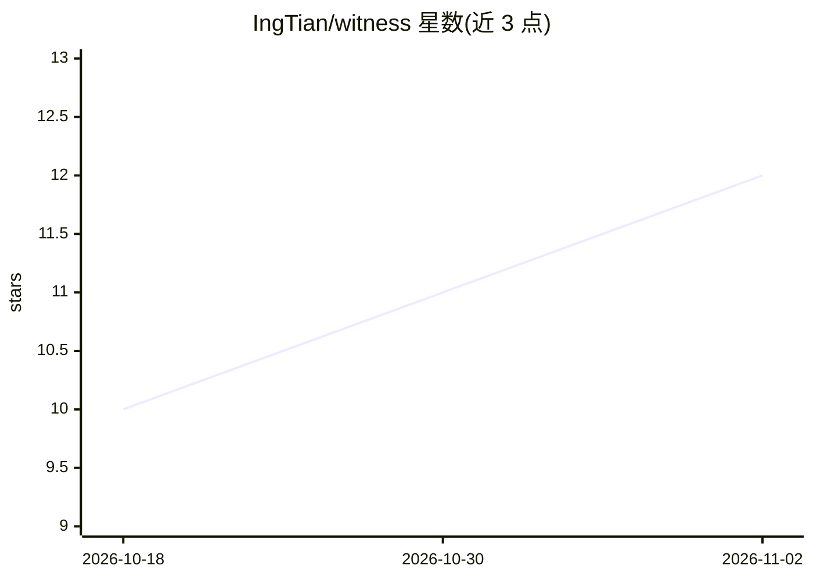

# IngTian/witness

⭐ 12 · Go · MIT · 推送 2026-11-01 · [GitHub](https://github.com/IngTian/witness) · [官网](https://github.com/IngTian/witness#readme) · 个人维护

**把 AI 编程会话或文本流变成带日期与溯源的变化史 MCP 服务**

纯 Go 单二进制的蒸馏引擎：后台捕获 Claude Code / OpenCode 会话（或经 witness ingest 喂入 NDJSON 语料），经 raw→observations→bi-temporal facets→profile 四层处理，把属性变化以 valid_from/valid_to 双时序记录而非覆盖，并保留驱动变化的来源证据；结果存于本地 SQLite 加 markdown，通过 MCP 供 agent 查询。架构仅收集/拉取，不向会话注入内容。机制通用但内置镜头均为“个人成长”取向，非个人语料需自写 lens（三文件目录）。

## 筛选速览

| 维度 | 判定 | 备注 |
|---|---|---|
| AI 角色 | `ai-ecosystem` | LLM/agent 周边工具 |
| 许可风险 | `permissive` | MIT |
| 部署形态 | `desktop` | 安装包/桌面程序 |
| 模型依赖 | — | README 未给出锁定关系 |
| 硬件要求 | — | 无带数字的原话,不猜 |
| 安装摩擦 | `medium` | 含编译或系统依赖之一 |
| 成熟度 | — | 结构信号不足 |

## 能力要点

- 四层结构：raw 逐字存档→观察→双时序 facets→按需生成的 profile 叙事
- 属性变化不覆盖，旧值按日期关闭并记录来源证据
- lens 机制：可注册领域镜头，支持 per-lens 指定模型
- 以 MCP server 形式供 agent 查询，收集/拉取式、不注入会话

## 适用场景

- 跨 AI 编程会话积累个人思维与工作习惯的可查询记忆
- 对市场评论/研究笔记等 NDJSON 语料建立变化史（自写 lens）
- 让 agent 通过 MCP 读取我的画像而不必每次重新解释背景

## 场景标签

`Agent 记忆` `知识库管理` · 领域:Agent 开发

## 证据(README 行号)

> L11: **witness turns a stream of text into a dated record of how its subject changed.** Feed it your AI
> L88: The archive is **collect-only / pull-only**: witness captures and distills everywhere, but never
> L89: injects anything into a session. Nothing is pushed — you (or an agent) read the profile on demand.

## 星数曲线

2026-10-18 10 → 2026-11-02 12（+2）

---
*卡片 v1 · prompt 1.4 · 生成 2026-11-02 · 置信度 high · 依据 README sha `53cb479500d0` · [字段定义](../../DATASET.md)*
