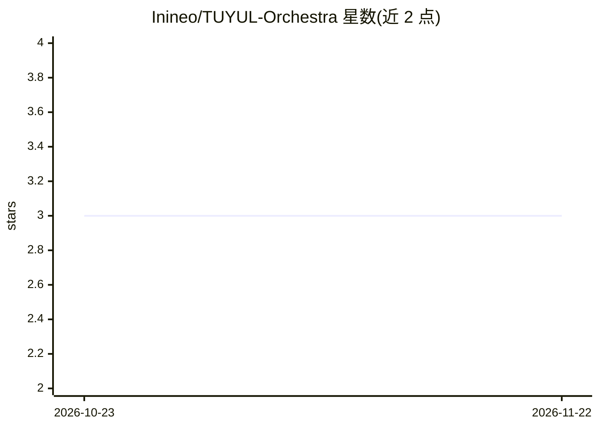

# Inineo/TUYUL-Orchestra

⭐ 3 · TypeScript · 推送 2026-10-26 · [GitHub](https://github.com/Inineo/TUYUL-Orchestra) · [官网](https://github.com/Inineo/TUYUL-Orchestra) · 个人维护 · 中文 README

**多智能体 AI 虚拟办公室：7 角色协作完成开发任务**

以 3D 虚拟办公室形式呈现的多智能体协调系统：7 个具有权限等级（0-10）与升级协议的功能角色（PM、研究员、前后端工程师、QA、评审、实习生）并行处理任务，经 9Router 网关接入多家模型并按任务复杂度动态选模，用 GitHub CLI 做议题驱动开发，集成 Strix 安全扫描与 Obsidian 知识库。前端 React+Three.js，后端 Python/FastAPI+SQLite 自动初始化。需本地运行 9Router（端口 20128）并配置 GitHub CLI 认证。

## 筛选速览

| 维度 | 判定 | 备注 |
|---|---|---|
| AI 角色 | `ai-native` | 本体是模型或模型工具 |
| 许可风险 | `none` | — |
| 部署形态 | `library` | 以包/库形式分发 |
| 模型依赖 | local-ok | 支持本地模型 |
| 硬件要求 | — | 无带数字的原话,不猜 |
| 安装摩擦 | `low` | 无编译、无系统依赖或容器化 |
| 成熟度 | — | 结构信号不足 |

## 能力要点

- 7 个权限分级角色（0-10）与低权限向上升级协议
- 9Router 网关接入 OpenAI/Anthropic/Gemini/DeepSeek/Ollama 等多提供商并按成本路由
- 敏感关键词任务拦截门，阻止泄露到公共 GitHub Issues
- Three.js 实时 3D 办公室渲染与任务看板监控

## 适用场景

- 用一个任务描述驱动多个 AI 角色协作产出代码
- 观察多智能体在 3D 界面中的任务分工与执行状态
- 让 AI 实习生自动创建 GitHub Issues 并配合安全扫描

## 场景标签

`多智能体` `编码 Agent` · 领域:Agent 开发

## 证据(README 行号)

> L15: **TUYUL** (**T**ask **U**nified **Y**ield & **U**tility **L**ayer) **Orchestra** is not just another AI chatbot — i
> L88: - **9Router** integration for multi-provider AI access (OpenAI, Anthropic, Gemini, DeepSeek, Ollama)
> L125: - **9Router** running locally on port `20128`

## 星数曲线

2026-10-23 3 → 2026-11-22 3（+0）

---
*卡片 v1 · prompt 1.4 · 生成 2026-11-22 · 置信度 high · 依据 README sha `dcb37ef155ce` · [字段定义](../../DATASET.md)*
