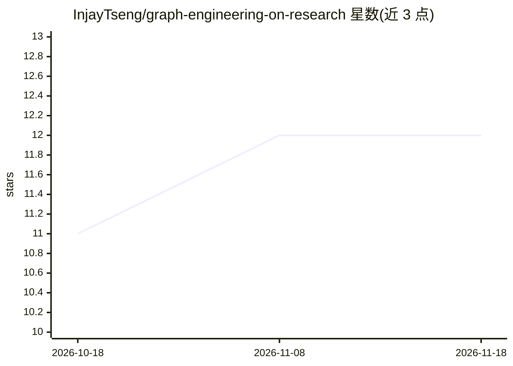

# InjayTseng/graph-engineering-on-research

⭐ 12 · Python · MIT · 推送 2026-08-31 · [GitHub](https://github.com/InjayTseng/graph-engineering-on-research) · [官网](https://davidyctseng.substack.com/p/agents) · 个人维护 · 中文 README

**给 AI agent 用户的并行化图结构提示词模板集**

六个自包含提示词模板加一个五分钟演示：假边审计、菱形研究（扇出并行检索+确定性合并+反驳层）、对抗评审、德尔菲圆桌、问题树与路由器。用户可整块复制粘贴到自己的 agent，或在 Claude Code 中以插件形式安装为斜杠命令，由其生成隔离子代理执行。支持英文与繁体中文输入。配套图解、真实运行记录与拒绝账本（.graph/ledger.md）格式约定。

## 筛选速览

| 维度 | 判定 | 备注 |
|---|---|---|
| AI 角色 | `ai-knowledge` | 知识聚合/清单类 |
| 许可风险 | `permissive` | MIT |
| 部署形态 | `None` |  |
| 模型依赖 | — | README 未给出锁定关系 |
| 硬件要求 | — | 无带数字的原话,不猜 |
| 安装摩擦 | `low` | 无编译、无系统依赖或容器化 |
| 成熟度 | — | 结构信号不足 |

## 能力要点

- 六个自包含模板：复制整块粘贴即可运行，主题填在末尾标记处
- Claude Code 插件安装后每个模板变为斜杠命令
- 反驳层设计规则：产出声明的节点不参与裁决，裁决须锚定外部证据
- 拒绝账本格式：每条被否决声明一行四字段，由后续轮次读取

## 适用场景

- 对不熟悉的研究主题做并行多角度检索并附置信标签
- 用隔离攻击者审查已定稿文档中的结论
- 用德尔菲两轮流程处理公开数据无法裁决的决策
- 把模糊大问题分解成可派发的问题树

## 场景标签

`提示工程` `科研工具` · 领域:Agent 开发

## 证据(README 行号)

> L11: Six templates plus a five-minute demo, five diagrams. Every file is self-contained: copy the whole block, paste it 
> L13: **Or skip the copy-paste entirely:** install as a Claude Code plugin and every template becomes a slash command — `
> L15: |Template|What it does|When to use it|

## 星数曲线

2026-10-18 11 → 2026-11-18 12（+1）

---
*卡片 v1 · prompt 1.4 · 生成 2026-11-18 · 置信度 high · 依据 README sha `9bf35ef88e95` · [字段定义](../../DATASET.md)*
