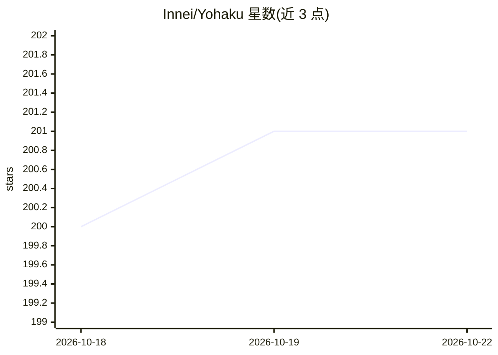

# Innei/Yohaku

⭐ 202 · TypeScript · 推送 2026-10-21 · [GitHub](https://github.com/Innei/Yohaku) · [官网](https://yohaku.innei.dev) · 个人维护 · 中文 README

**面向个人写作的跨端出版产品：iOS 客户端与设计系统（MIT 开源）**

Yohaku 是以 mx-core 为内容后端的跨端出版产品，本仓库公开三部分：面向单一站点的 iOS 原生阅读客户端（iOS 18+，MIT，可自行换 bundle id 后上架 App Store）、设计系统（色彩/字体/间距/动效/模板及面向 AI 助手的 AI Skill 契约）、跨端富文本渲染包。完整 Web 版闭源，需赞助获取访问权限，要求 mx-core v12+。本地运行需 Node.js 22+、pnpm、Xcode。推送依赖仓库外自建 APNs 中转服务。

## 筛选速览

| 维度 | 判定 | 备注 |
|---|---|---|
| AI 角色 | `ai-enhanced` | 去掉 AI 部分产品仍成立 |
| 许可风险 | `none` | — |
| 部署形态 | `library` | 以包/库形式分发 |
| 模型依赖 | — | README 未给出锁定关系 |
| 硬件要求 | — | 无带数字的原话,不猜 |
| 安装摩擦 | `low` | 无编译、无系统依赖或容器化 |
| 成熟度 | — | 结构信号不足 |

## 能力要点

- iOS 客户端完整源码以 MIT 开源，可自行配置后上架 App Store
- 设计系统含色彩/字体/间距/动效模板与 AI Skill 契约
- 跨端富文本渲染包 packages/rich-content
- 提供设计系统 Showcase 与 PDF 排版范例生成命令

## 适用场景

- 用自己的 mx-core 站点编译并上架个人 iOS 阅读客户端
- 复用排版设计系统与 Token 规范做长文阅读产品
- 生成简历、报告等排版 PDF 范例

## 场景标签

 · 领域:内容出版/设计系统

## 证据(README 行号)

> L11: Yohaku 是一套面向个人写作的跨端出版产品。它以 mx-core 为内容后端，在 Web 与 iOS 上统一呈现文章、手记、思考与时间线；界面退居其后，让文字、节奏与阅读本身成为主角。
> L26: |**设计系统**|色彩、字体、间距、动效、模板与面向 AI 助手的 AI Skill 契约|MIT 开源|

## 星数曲线

2026-10-18 200 → 2026-10-22 201（+1）

---
*卡片 v1 · prompt 1.4 · 生成 2026-10-22 · 置信度 high · 依据 README sha `e19dfc9704ad` · [字段定义](../../DATASET.md)*
