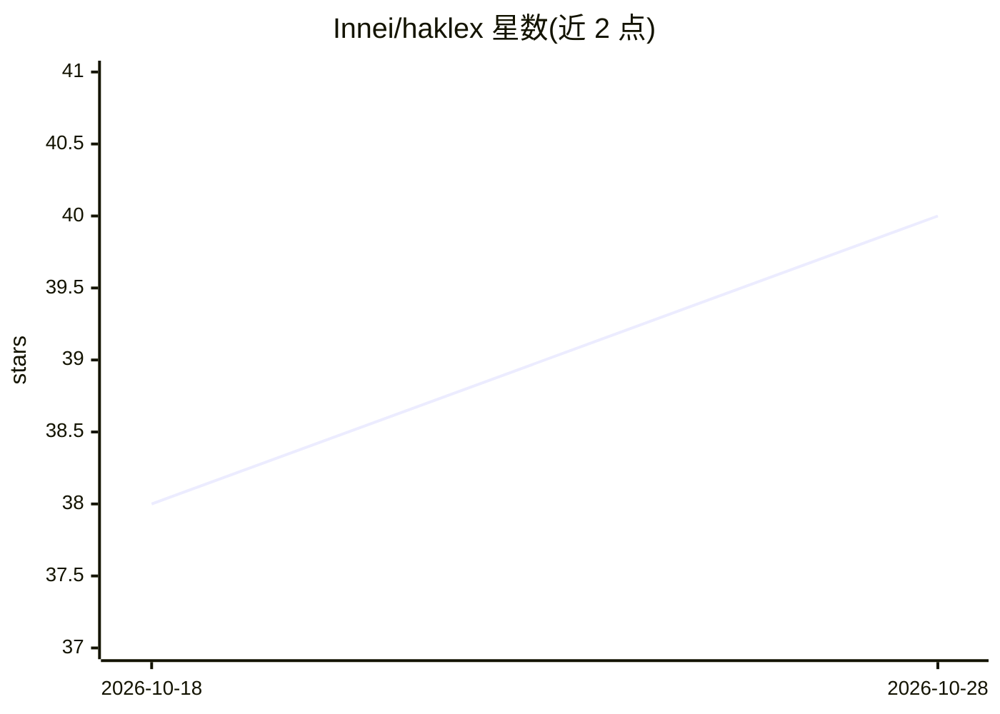

# Innei/haklex

⭐ 40 · TypeScript · 推送 2026-10-27 · [GitHub](https://github.com/Innei/haklex) · [官网](https://haklex.innei.dev) · 个人维护 · 中文 README

**面向 React 开发者的 AI-agent 原生富文本编辑器生态**

基于 Lexical 的富文本编辑器 monorepo，含 20 余个 @haklex/* 包：核心编辑器、静态渲染器、服务端解析（Lexical JSON→Markdown）、插件与扩展。AI 相关部分：LiteXML 双向序列化桥（Lexical JSON↔XML，供 LLM 读写文档）、AI 写作 agent 扩展（diff 审查浮层、流式文档编辑）、headless agent 协议与聊天面板。技术栈为 React 19、TypeScript、Vanilla Extract，仅 ESM，需 Node.js≥22.12 与 pnpm 12，通过源码 clone 构建使用。

## 筛选速览

| 维度 | 判定 | 备注 |
|---|---|---|
| AI 角色 | `ai-ecosystem` | LLM/agent 周边工具 |
| 许可风险 | `none` | — |
| 部署形态 | `library` | 以包/库形式分发 |
| 模型依赖 | — | README 未给出锁定关系 |
| 硬件要求 | — | 无带数字的原话,不猜 |
| 安装摩擦 | `low` | 无编译、无系统依赖或容器化 |
| 成熟度 | — | 结构信号不足 |

## 能力要点

- LiteXML 双向序列化：Lexical JSON↔XML，供 LLM 读写结构化文档
- AI 写作 agent：diff 审查浮层、动作注册表、流式文档编辑
- 静态/编辑分离的节点与渲染器树，支持 SSR 与零 React 服务端解析
- 三种排版变体（article/note/comment）与模块化组合 API

## 适用场景

- 为 React 应用集成支持 AI 协作编辑的富文本编辑器
- 让 LLM agent 通过 LiteXML 协议读取和修改结构化文档
- 博客/笔记/评论场景的只读渲染与服务端 Markdown 转换

## 场景标签

`AI 写作` · 领域:内容生成

## 证据(README 行号)

> L3:  An AI-agent-native rich text editor ecosystem built on Lexical.
> L9: - **LiteXML Bridge** — Bidirectional Lexical JSON ↔ XML serialization (`@haklex/rich-litexml`) enables LLMs to read 
> L160: |`@haklex/rich-agent-core`|Headless AI agent protocol, LiteXML-backed edits, and document/session state|

## 星数曲线

2026-10-18 38 → 2026-10-28 40（+2）

---
*卡片 v1 · prompt 1.4 · 生成 2026-10-25 · 置信度 mid · 依据 README sha `bf41aa53970e` · [字段定义](../../DATASET.md)*
