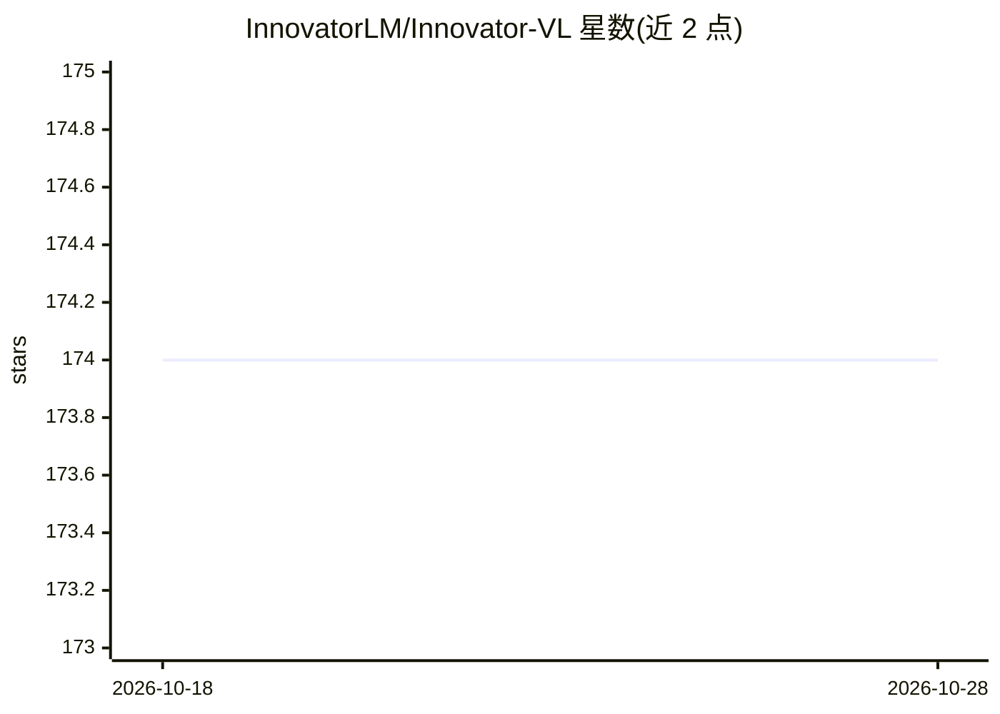

# InnovatorLM/Innovator-VL

⭐ 174 · Python · MIT · 推送 2026-03-20 · [GitHub](https://github.com/InnovatorLM/Innovator-VL) · [官网](https://innovatorlm.github.io/Innovator-VL/) · 组织维护 · 中文 README

**面向科学发现的多模态大模型（8B），含全流程开源训练管线**

Innovator-VL 是科学领域多模态大语言模型，基于 Qwen3-8B 语言解码器、RICE-ViT 视觉编码器与 PatchMerger 投影层构建，提供 Instruct 与 Thinking 两个 8B 检查点。训练数据少于 500 万条精选科学样本，公开从数据收集、清洗、对齐、中训、指令微调到 GSPO 强化学习的端到端复现管线，训练基于 Megatron-LM，评测使用 lmms-eval 框架，覆盖通用视觉、数学推理与化学/生物/医学/地学等科学基准。模型与数据集托管于 Hugging Face，本地通过 transformers 加载推理。

## 筛选速览

| 维度 | 判定 | 备注 |
|---|---|---|
| AI 角色 | `ai-native` | 本体是模型或模型工具 |
| 许可风险 | `permissive` | MIT |
| 部署形态 | `library` | 以包/库形式分发 |
| 模型依赖 | — | README 未给出锁定关系 |
| 硬件要求 | — | 无带数字的原话,不猜 |
| 安装摩擦 | `low` | 无编译、无系统依赖或容器化 |
| 成熟度 | — | 结构信号不足 |

## 能力要点

- 8B 科学多模态模型，含 Instruct 与 Thinking 两个检查点，基于 Qwen3-8B + RICE-ViT 架构
- 少于 500 万精选样本的训练配方，公开全部模型、数据与训练代码
- 四阶段训练管线：对齐、中训（85M）、指令微调（46M）、GSPO 强化学习（172K）
- lmms-eval 评测脚本覆盖通用视觉、数学推理与科学（化学/生物/医学/遥感）基准

## 适用场景

- 我需要一个可直接推理的科学多模态模型处理图表、分子式、显微图像等科学视觉问答
- 我想复现或继续训练一个科学领域 MLLM 的完整流程
- 我在科学基准上评测多模态模型的推理能力

## 场景标签

`多模态` `模型训练` `微调` `强化学习` · 领域:感知与多模态

## 证据(README 行号)

> L62: **Innovator-VL** is a scientific multimodal large language model designed to advance multimodal understanding and r
> L100:  Figure 2: Innovator-VL architecture with RICE-ViT visual encoder, PatchMerger, and Qwen3 language decoder

## 星数曲线

2026-10-18 174 → 2026-10-28 174（+0）

---
*卡片 v1 · prompt 1.4 · 生成 2026-10-23 · 置信度 high · 依据 README sha `0ecdeee160ae` · [字段定义](../../DATASET.md)*
