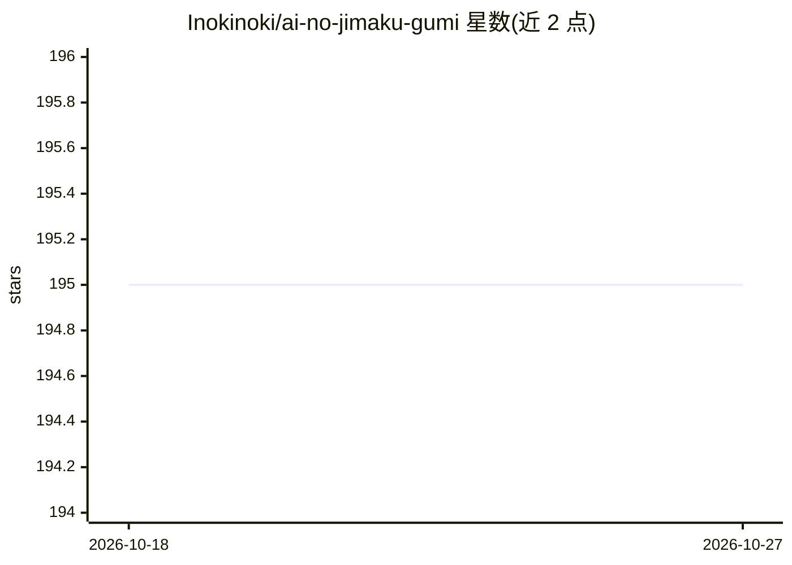

# Inokinoki/ai-no-jimaku-gumi

⭐ 195 · Rust · MIT · 推送 2026-10-08 · [GitHub](https://github.com/Inokinoki/ai-no-jimaku-gumi) · 个人维护 · 中文 README

**用 AI 为视频生成翻译字幕的 CLI 工具**

Rust 编写的命令行工具：读取视频，用 Whisper（whisper.cpp 模型）从音轨转录字幕，或直接抽取容器内已有字幕轨，再经 DeepL（默认）、LLM 或 Whisper 实验性通道翻译，输出 SRT 文件、嵌入容器字幕轨或烧录进画面（H.264 重编码，需系统字体）。支持多平台构建：macOS/Linux/Windows 各有依赖安装说明，Windows 需固定 LLVM 17 与 ffmpeg 7.1 共享构建。需 cargo build 编译并自行下载 whisper 模型。

## 筛选速览

| 维度 | 判定 | 备注 |
|---|---|---|
| AI 角色 | `ai-native` | 本体是模型或模型工具 |
| 许可风险 | `permissive` | MIT |
| 部署形态 | `desktop` | 安装包/桌面程序 |
| 模型依赖 | — | README 未给出锁定关系 |
| 硬件要求 | — | 无带数字的原话,不猜 |
| 安装摩擦 | `high` | 编译与系统依赖俱全 |
| 成熟度 | `idea` | |

## 能力要点

- Whisper 音轨转录生成字幕，或抽取视频容器内已有文本字幕轨
- 三种翻译后端：DeepL API（默认）、LLM（rust-genai）、Whisper 实验性直译（仅英语音频）
- 三种输出方式：SRT 文件、容器字幕轨、烧录进画面
- 跨平台构建说明（macOS/Linux/Windows）

## 适用场景

- 为外语视频自动生成翻译字幕文件
- 将已有字幕轨提取并翻译成目标语言
- 直接把翻译字幕烧录进视频画面

## 场景标签

`语音识别` · 领域:感知与多模态

## 证据(README 行号)

> L5: AI no jimaku gumi is a cli utility to facilitate the translation and subtitle making of video.
> L114: - `audio` (default): transcribe the audio track using Whisper.
> L110: We are currently supporting only `deepl`, `llm`, `whisper` translation and `srt`, `container`, `embedded` export.

## 星数曲线

2026-10-18 195 → 2026-10-27 195（+0）

---
*卡片 v1 · prompt 1.4 · 生成 2026-10-22 · 置信度 high · 依据 README sha `7a55c0d3a6ac` · [字段定义](../../DATASET.md)*
