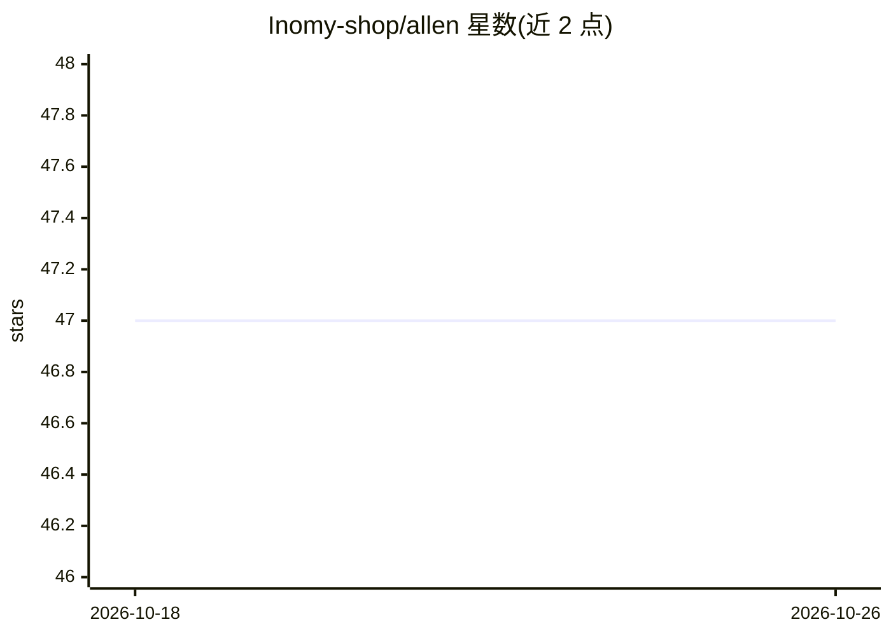

# Inomy-shop/allen

⭐ 47 · TypeScript · MIT · 推送 2026-09-04 · [GitHub](https://github.com/Inomy-shop/allen) · [官网](https://askallen.build/) · 组织维护

**在真实仓库上运行的多 Agent 软件开发编排系统**

面向软件开发团队的开源多 Agent 编排平台：内置 6 个团队、20+ 个 Agent（团队主管编排、专家 Agent 写码/评审/测试/修 bug），以 YAML 工作流定义多步流水线（agent/code/condition/human 节点、并行分支、子工作流），每个编码任务在独立 git worktree 中运行并带实时终端。人类在 intervention 检查点审批，执行全程有 trace、日志、token/成本统计。集成 GitHub、Linear、Slack、MCP，聊天默认由 Codex CLI 驱动，也可切换 Claude Code（必需安装）作为执行引擎。自述为早期 alpha，建议先用非关键仓库。

## 筛选速览

| 维度 | 判定 | 备注 |
|---|---|---|
| AI 角色 | `ai-ecosystem` | LLM/agent 周边工具 |
| 许可风险 | `permissive` | MIT |
| 部署形态 | `library` | 以包/库形式分发 |
| 模型依赖 | — | README 未给出锁定关系 |
| 硬件要求 | — | 无带数字的原话,不猜 |
| 安装摩擦 | `low` | 无编译、无系统依赖或容器化 |
| 成熟度 | `idea` | |

## 能力要点

- 6 团队 / 20+ Agent 的种子组织与委托树
- YAML 工作流：并行分支、条件、人工检查点，内置 9 个工作流
- 每个任务独立 git worktree + WebSocket PTY 终端 + 预览代理
- 执行可观测：trace、按节点 token/成本分解、Mermaid 图

## 适用场景

- 把 Linear 工单或聊天任务分派给 Agent 团队在真实仓库执行
- 通过人工审批检查点控制 Agent 的代码修改流程
- 跨仓库变更的多级编排与 PR 自动生成/评审处理

## 场景标签

`多智能体` `编码 Agent` · 领域:Agent 开发

## 证据(README 行号)

> L7: Allen runs a multi-team organization of AI agents against your codebases. You talk to it in chat or hand it a Linear
> L49: - **Claude Code CLI — required.** Installed via the official standalone installer (`curl -fsSL https://claude.ai/in

## 星数曲线

2026-10-18 47 → 2026-10-26 47（+0）

---
*卡片 v1 · prompt 1.4 · 生成 2026-10-25 · 置信度 mid · 依据 README sha `46bc0fbca13c` · [字段定义](../../DATASET.md)*
