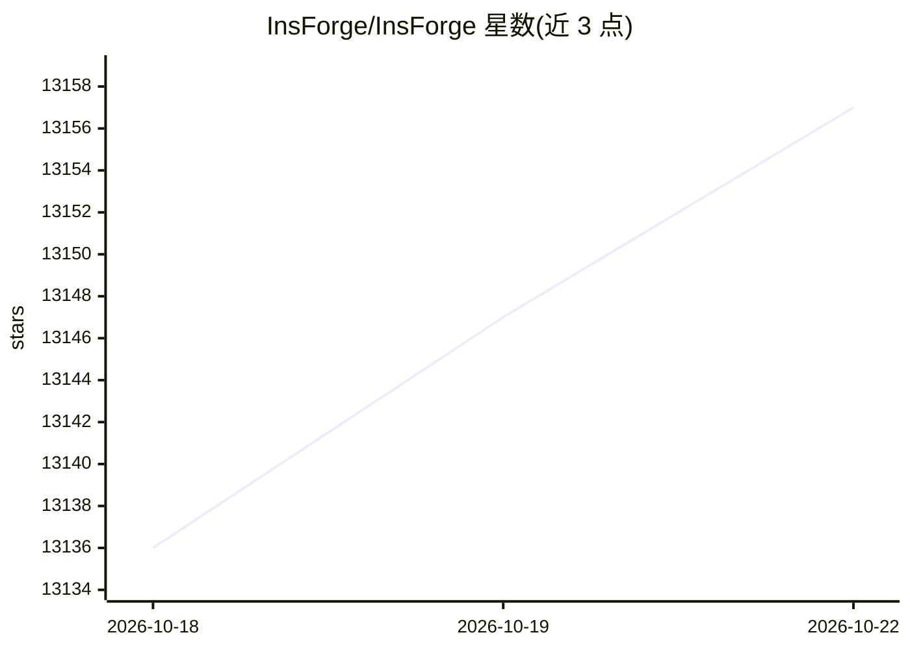

# InsForge/InsForge

⭐ 13,158 · TypeScript · Apache-2.0 · 推送 2026-10-22 · [GitHub](https://github.com/InsForge/InsForge) · [官网](https://insforge.dev) · 组织维护

**为编码 Agent 提供数据库/认证/存储/托管的一体化后端平台**

开源后端平台，将数据库（Postgres）、用户认证、S3 兼容存储、Model Gateway、边缘函数、站点部署等能力打包为一套可自托管的服务。编码 Agent 通过 MCP Server（自托管与云）或 CLI + Skills（仅云）两种接口调用其操作：读取后端 schema、元数据与运行日志，执行数据库迁移、部署边缘函数、创建存储桶、配置认证提供方等。自托管经 Docker Compose 完成，要求 Docker 与 Compose v2，默认本地文件系统存储，可挂接 S3 兼容存储后端。

## 筛选速览

| 维度 | 判定 | 备注 |
|---|---|---|
| AI 角色 | `ai-native` | 本体是模型或模型工具 |
| 许可风险 | `permissive` | Apache-2.0 |
| 部署形态 | `self-host` | docker 或自建部署 |
| 模型依赖 | — | README 未给出锁定关系 |
| 硬件要求 | — | 无带数字的原话,不猜 |
| 安装摩擦 | `low` | 无编译、无系统依赖或容器化 |
| 成熟度 | — | 结构信号不足 |

## 动量与使用信号

- 维护:`active` — 距上次 push 4.5 天,年发版 56,119 位贡献者
- 涨星:近 1 天 **+8**(自 20261016 起算)
- 平台:— · 协议:OPENAI-API / MCP

## 能力要点

- 通过 MCP Server 将后端操作暴露为 Agent 可调用工具
- Postgres 数据库、认证、S3 兼容存储、边缘函数、站点部署一体化
- Model Gateway 提供 OpenAI 兼容 API 跨多个 LLM 提供方
- 支持 Docker Compose 自托管与 Railway/Zeabur/Sealos 等一键部署

## 适用场景

- 让编码 Agent 端到端搭建并运维全栈应用的后端
- 自托管一套含数据库、认证与存储的应用后端
- 通过统一网关调用多个 LLM 提供方

## 场景标签

`模型网关` · 领域:Agent 开发

## 证据(README 行号)

> L32: The all-in-one, open-source backend platform for agentic coding. InsForge gives your coding agent database, auth, s
> L40: - **MCP Server** (self-hosted and cloud): exposes InsForge's operations as tools any MCP-compatible agent can call.
> L78: Prerequisites: Docker with Compose v2.

## 星数曲线

2026-10-18 13,136 → 2026-10-22 13,157（+21）

---
*卡片 v1 · prompt 1.4 · 生成 2026-10-18 · 置信度 high · 依据 README sha `1ff707924931` · [字段定义](../../DATASET.md)*
