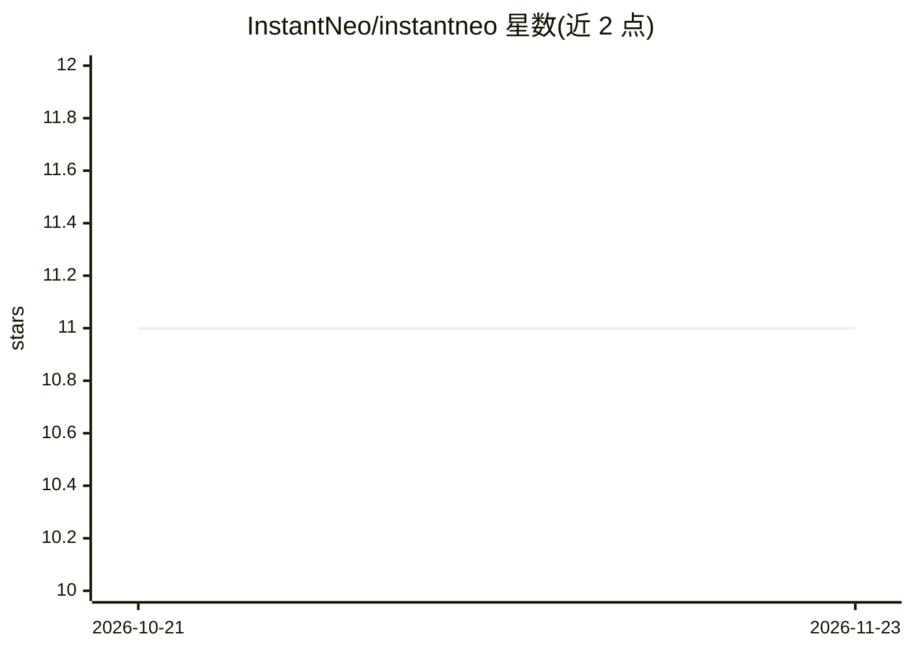

# InstantNeo/instantneo

⭐ 11 · Python · MIT · 推送 2026-09-05 · [GitHub](https://github.com/InstantNeo/instantneo) · 个人维护

**Python 库：快速创建可控组合的 LLM 智能体**

InstantNeo 是一个 Python 库，用于快速创建基于 LLM 的智能体，定位为智能系统的组件。提供统一的模型提供商接口、基于装饰器的工具管理（含参数校验）、三种工具执行模式（等待结果/后台执行/仅抽取参数）、文本与图像统一 API，以及运行时可覆盖的智能体参数。v2 引入事件溯源编排层 InstantLoop，包含 History 日志、Monitor 规则引擎与 RunLog 调试日志，用于构建多智能体系统。通过 pip 安装，MIT 许可。

## 筛选速览

| 维度 | 判定 | 备注 |
|---|---|---|
| AI 角色 | `ai-ecosystem` | LLM/agent 周边工具 |
| 许可风险 | `permissive` | MIT |
| 部署形态 | `library` | 以包/库形式分发 |
| 模型依赖 | — | README 未给出锁定关系 |
| 硬件要求 | — | 无带数字的原话,不猜 |
| 安装摩擦 | `low` | 无编译、无系统依赖或容器化 |
| 成熟度 | — | 结构信号不足 |

## 能力要点

- 统一提供商接口，一致语法切换模型提供商
- Python 装饰器定义工具，动态增删与参数校验
- 三种执行模式：等待响应、仅执行、仅提取参数
- v2 事件溯源编排：History/Monitor/InstantLoop/RunLog

## 适用场景

- 用 Python 函数快速封装 LLM 工具调用
- 组合多个专职智能体构建多智能体系统
- 需要精细控制智能体行为与工具执行时机的应用
- 带视觉能力模型的图像+文本处理流程

## 场景标签

`Agent 框架` `多智能体` · 领域:Agent 开发

## 证据(README 行号)

> L14: InstantNeo is a Python library that lets you create LLM-based agents quickly and concisely, designed as components 
> L61: ## v2 — Event-sourced Orchestration (`InstantLoop`)

## 星数曲线

2026-10-21 11 → 2026-11-23 11（+0）

---
*卡片 v1 · prompt 1.4 · 生成 2026-11-19 · 置信度 high · 依据 README sha `ad4b7071610a` · [字段定义](../../DATASET.md)*
