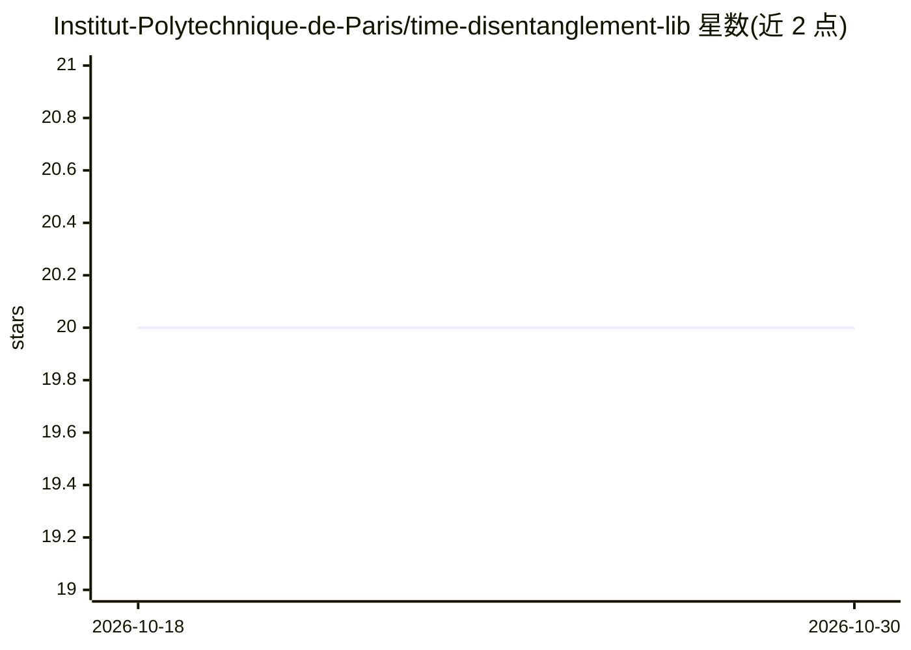

# Institut-Polytechnique-de-Paris/time-disentanglement-lib

⭐ 20 · Python · 推送 2025-12-11 · [GitHub](https://github.com/Institut-Polytechnique-de-Paris/time-disentanglement-lib) · [官网](https://institut-polytechnique-de-paris.github.io/time-disentanglement-lib/) · 组织维护

**面向时序解耦表示学习研究的 PyTorch 实验框架**

由巴黎综合理工学院团队维护的 PyTorch 库，围绕时序数据的解耦表示学习组织研究工作流：收录 DIoSC（作者的 ICLR 2024 方法）及 S3VAE、CoST、β-VAE、FactorVAE 等时序与静态基线实现，内置 Beta-VAE Score、MIG、DCI、SAP 等 7 种解耦度量，并提供 UK-DALE、MNIST、dSprites 等数据集的预配置实验命令以复现结果。通过克隆仓库并 pip 安装依赖使用，PyPI 包尚未发布。

## 筛选速览

| 维度 | 判定 | 备注 |
|---|---|---|
| AI 角色 | `ai-native` | 本体是模型或模型工具 |
| 许可风险 | `none` | — |
| 部署形态 | `library` | 以包/库形式分发 |
| 模型依赖 | — | README 未给出锁定关系 |
| 硬件要求 | — | 无带数字的原话,不猜 |
| 安装摩擦 | `low` | 无编译、无系统依赖或容器化 |
| 成熟度 | — | 结构信号不足 |

## 能力要点

- 实现 DIoSC（ICLR 2024）及时序/静态两大类共 14 个解耦模型
- 内置 7 种标准解耦评估度量（MIG/DCI/SAP/UDR 等）
- 预配置实验命令支持 UK-DALE、MNIST、dSprites 等数据集复现

## 适用场景

- 运行并对比时序解耦表示学习的基线模型
- 用标准度量评估表示的解耦质量
- 复现 DIoSC 论文实验结果

## 场景标签

 · 领域:机器学习/表示学习

## 证据(README 行号)

> L3: **A comprehensive PyTorch library for Disentangled Representation Learning in Time Series.**
> L11: **Time-Disentanglement-Lib** is a modular framework designed to facilitate research in disentangled representation 
> L15: 1. **SOTA Baselines:** Implementations of leading time-series and static disentanglement models.

## 星数曲线

2026-10-18 20 → 2026-10-30 20（+0）

---
*卡片 v1 · prompt 1.4 · 生成 2026-10-28 · 置信度 mid · 依据 README sha `4fb03ef0ce8d` · [字段定义](../../DATASET.md)*
