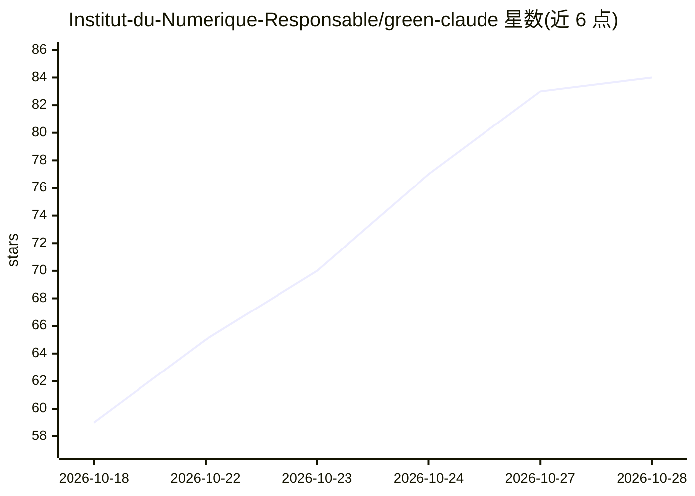

# Institut-du-Numerique-Responsable/green-claude

⭐ 84 · Shell · NOASSERTION · 推送 2026-10-26 · [GitHub](https://github.com/Institut-du-Numerique-Responsable/green-claude) · [官网](https://institut-du-numerique-responsable.github.io/green-claude/) · 组织维护

**让 Claude Code 编写更省资源代码的生态设计技能与本地审计工具**

由法国数字责任研究院（INR）维护的 Claude Code 技能插件：以 107 条通用规则、24 种语言框架的 127 条专属规则、13 条负责任使用实践与 30 条 token 节制规则引导模型编写低资源消耗代码，规则依据 RGESN 2024 与 GR491。附带本地审计脚本 eco-audit.sh（基于模式检测、不调用模型）与 eco-score.sh 密度评分；声明审计仅标记待复核项，不认证 RGESN 合规、不测量能耗。支持 Claude Code 插件管理器、install.sh 脚本，以及打包上传 Claude.ai 与 Claude API 两种渠道。

## 筛选速览

| 维度 | 判定 | 备注 |
|---|---|---|
| AI 角色 | `ai-ecosystem` | LLM/agent 周边工具 |
| 许可风险 | `none` | NOASSERTION |
| 部署形态 | `None` |  |
| 模型依赖 | locked-api |  |
| 硬件要求 | — | 无带数字的原话,不猜 |
| 安装摩擦 | `low` | 无编译、无系统依赖或容器化 |
| 成熟度 | — | 结构信号不足 |

## 能力要点

- 107 条通用规则覆盖 RGESN 2024 全部 9 个家族，并新增 AI 托管类别
- 24 种语言/框架的 127 条规则按文件扩展名按需加载
- 本地审计脚本 eco-audit.sh 基于模式检测，无需调用模型
- 30 条 NR-TOK 规则面向开发 agent 降低 token 与模型调用消耗

## 适用场景

- 让 Claude Code 在写代码时默认遵循生态设计规则
- 对现有文件做生态设计审计或全仓库模式密度评分
- 团队在 PR 流水线中运行规则测试并发布密度报告

## 场景标签

`代码审查` · 领域:编码与开发

## 证据(README 行号)

> L9: **Green Claude** helps Claude Code write code that uses fewer resources, with eco-design rules and a local audit too
> L24: /plugin marketplace add Institut-du-Numerique-Responsable/green-claude

## 星数曲线

2026-10-18 59 → 2026-10-28 84（+25）

---
*卡片 v1 · prompt 1.4 · 生成 2026-10-24 · 置信度 high · 依据 README sha `6c5bc982afcc` · [字段定义](../../DATASET.md)*
