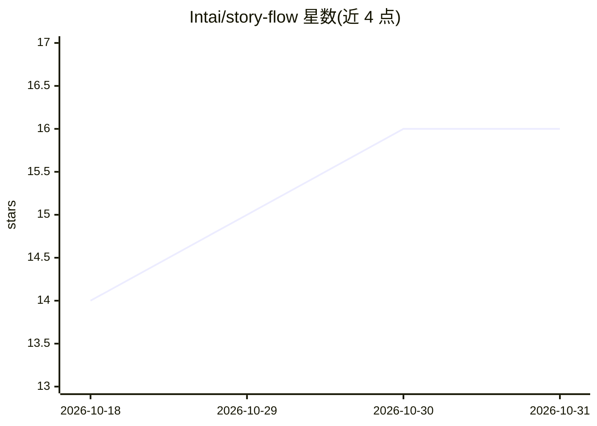

# Intai/story-flow

⭐ 16 · TypeScript · MIT · 推送 2026-10-29 · [GitHub](https://github.com/Intai/story-flow) · 个人维护

**基于 Claude Code 的用户故事到 BDD 测试全流程工作流插件**

发布到 Claude Code marketplace 的插件集合，覆盖从技术故事起草、评审、任务依赖分析、实现、BDD 场景执行到最终 PR 准备的 9 步 agentic 开发流程。任务实现由隔离上下文的 subagent 并行执行；可生成脱离 Claude 独立运行的 Playwright 回归脚本；支持通过自定义 skills 扩展领域知识，并配置 Appium、BrowserStack、Visual Regression Tracker 等环境变量用于移动端与视觉回归测试。前提是故事已在 Jira/ClickUp 等跟踪器中完成梳理，且项目相关 MCP server 与 CLI 已安装登录。

## 筛选速览

| 维度 | 判定 | 备注 |
|---|---|---|
| AI 角色 | `ai-ecosystem` | LLM/agent 周边工具 |
| 许可风险 | `permissive` | MIT |
| 部署形态 | `library` | 以包/库形式分发 |
| 模型依赖 | locked-api |  |
| 硬件要求 | — | 无带数字的原话,不猜 |
| 安装摩擦 | `low` | 无编译、无系统依赖或容器化 |
| 成熟度 | — | 结构信号不足 |

## 能力要点

- 9 步工作流：故事起草→评审→依赖分析→实现→BDD 执行→PR
- 任务由隔离子代理并行执行，避免耗尽上下文窗口
- BDD 场景可在浏览器中直接执行并录制为可独立运行的 Playwright 回归脚本
- 通过 .claude/skills 目录按命名约定添加自定义领域技能

## 适用场景

- 团队以人机协作方式把敏捷故事自动实现为带完整 BDD 覆盖的代码
- 把 BDD 场景录制为 Playwright 脚本用于回归测试
- 自动分诊回归流水线中失败的测试场景

## 场景标签

`编码 Agent` `工作流自动化` · 领域:效率与自动化

## 证据(README 行号)

> L3: This workflow leverages Claude Code to automate and streamline software development, from story planning to fully te
> L139: Add this marketplace to Claude Code:

## 星数曲线

2026-10-18 14 → 2026-10-31 16（+2）

---
*卡片 v1 · prompt 1.4 · 生成 2026-10-30 · 置信度 mid · 依据 README sha `4cb086dd6d3c` · [字段定义](../../DATASET.md)*
