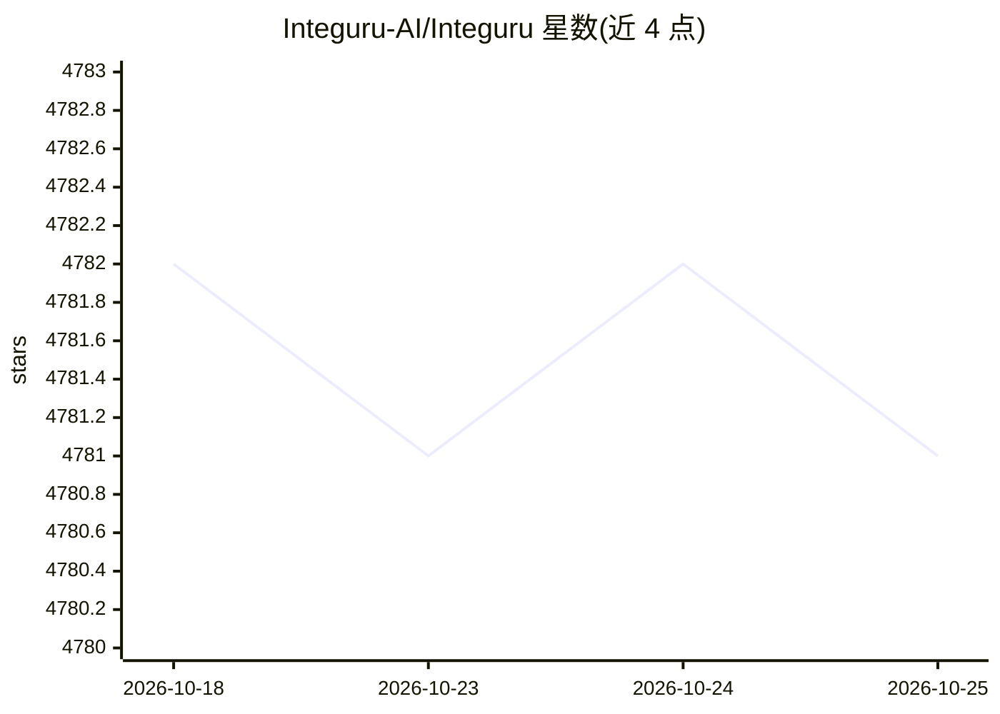

# Integuru-AI/Integuru

⭐ 4,780 · Python · AGPL-3.0 · 推送 2026-06-24 · [GitHub](https://github.com/Integuru-AI/Integuru) · [官网](https://integuru.ai) · 组织维护

**逆向平台内部 API 并生成可运行集成代码的 AI agent**

面向需要对接无官方 API 平台的开发者：用户用 create_har.py 抓取浏览器网络请求与 cookies，并以自然语言描述目标操作（如下载账单）；agent 识别触发该操作的内部请求，分析请求间的动态参数依赖并构建依赖图，遍历图生成可运行的 Python 代码去调用平台内部端点。本仓库为其最早公开版本（v0），新版本已迁移至 integuru.com。依赖云端 LLM（OpenAI GPT-4o/o1 系列），推荐具备 function calling 能力的模型；输入变量目前仅支持图生成阶段，代码生成阶段暂不支持。

## 筛选速览

| 维度 | 判定 | 备注 |
|---|---|---|
| AI 角色 | `ai-native` | 本体是模型或模型工具 |
| 许可风险 | `viral` | AGPL-3.0 |
| 部署形态 | `None` |  |
| 模型依赖 | — | README 未给出锁定关系 |
| 硬件要求 | — | 无带数字的原话,不猜 |
| 安装摩擦 | `low` | 无编译、无系统依赖或容器化 |
| 成熟度 | `idea` | |

## 能力要点

- 从 HAR 网络请求数据构建请求间依赖图
- 生成调用平台内部端点的可运行 Python 代码
- 支持 OpenAI 多模型（gpt-4o/o3-mini/o1/o1-mini），图生成与代码生成可自动切换模型
- 支持带 2FA 站点（需先完成认证获取 cookies/token）

## 适用场景

- 对接没有官方 API 的平台，自动化执行如下载账单等操作
- 逆向分析平台内部请求的参数依赖关系
- 为已有账号会话生成可复用的集成脚本

## 场景标签

`代码生成` `工作流自动化` · 领域:效率与自动化

## 证据(README 行号)

> L13: You use ```create_har.py``` to generate a file containing all browser network requests, a file with the cookies, an
> L41: - Generate code to hit all requests in the graph to perform the desired action.
> L121: The tool uses a cloud-based LLM (OpenAI's GPT-4o and o1-preview models).

## 星数曲线



2026-10-18 4,782 → 2026-10-25 4,781（-1）


---
*卡片 v1 · prompt 1.4 · 生成 2026-10-20 · 置信度 mid · 依据 README sha `8468642d9f31` · [字段定义](../../DATASET.md)*
