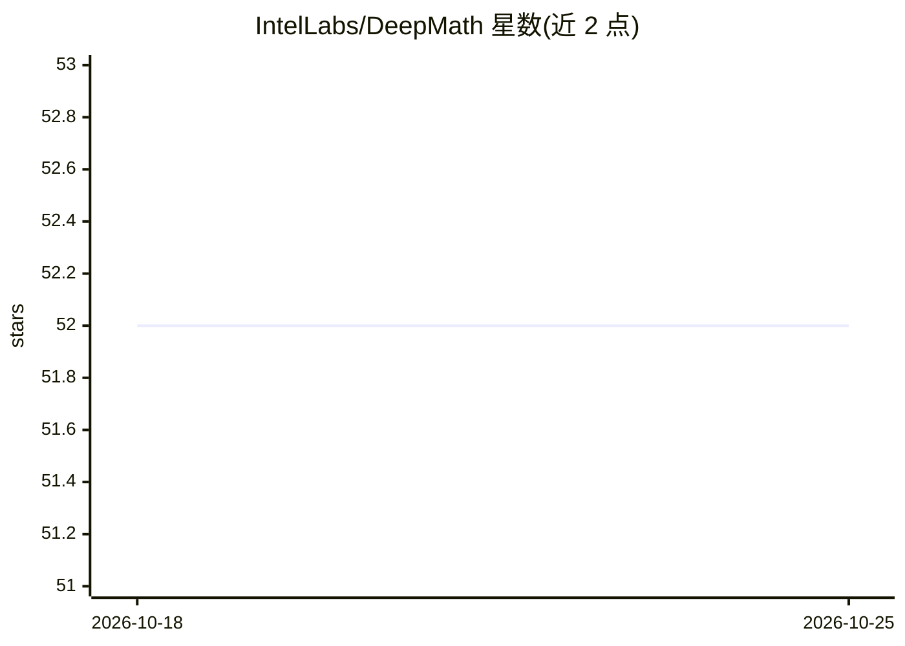

# IntelLabs/DeepMath

⭐ 52 · Python · Apache-2.0 · 推送 2026-10-21 · [GitHub](https://github.com/IntelLabs/DeepMath) · 组织维护

**训练与评测数学推理 agent 的框架：小模型+沙箱执行器+GRPO**

Intel Labs 发布的轻量级数学推理 agent 框架：基于 Qwen3-4B Thinking，经 GRPO 微调，推理时模型生成短 Python 片段，在受限沙箱（无文件 I/O、无网络、超时限制）中执行并把结果折回推理链。训练基于 TRL 的 GRPO trainer 并修改其 vLLM client/server，推理基于 SmolAgents 并以 vLLM 为引擎；提供训练、推理、评测脚本，用 uv 安装，训练需多卡 CUDA。局限：仅评估竞赛类数学，执行生成代码存在风险需管控。

## 筛选速览

| 维度 | 判定 | 备注 |
|---|---|---|
| AI 角色 | `ai-ecosystem` | LLM/agent 周边工具 |
| 许可风险 | `permissive` | Apache-2.0 |
| 部署形态 | `library` | 以包/库形式分发 |
| 模型依赖 | local-ok | 支持本地模型 |
| 硬件要求 | — | 无带数字的原话,不猜 |
| 安装摩擦 | `low` | 无编译、无系统依赖或容器化 |
| 成熟度 | — | 结构信号不足 |

## 能力要点

- 沙箱执行短 Python 片段并折回推理链，限制为无文件 I/O、无网络、超时
- 基于 TRL GRPO trainer 修改 vLLM client/server 生成训练候选
- 在 MATH500/AIME/HMMT/HLE 四个数据集上评测，输出长度最多减少 66%
- 基于 SmolAgents 构建数学 agent，vLLM 作为推理引擎

## 适用场景

- 训练与微调自己的数学推理 agent 模型
- 复现 GRPO+工具执行的消融实验与评测
- 研究代码沙箱执行对 LLM 数学推理长度与准确率的影响

## 场景标签

`Agent 框架` `强化学习` `模型评测` · 领域:Agent 开发

## 证据(README 行号)

> L43: - Inference: based on SmolAgents, a math agent was created. vLLM is used as the inference engine.
> L44: - Training: based on the GRPO trainer in TRL, we modified TRL's vLLM client and server to generate GRPO completions
> L145: 1. **Start the vLLM server** (for generating completions during GRPO training):

## 星数曲线

2026-10-18 52 → 2026-10-25 52（+0）

---
*卡片 v1 · prompt 1.4 · 生成 2026-10-24 · 置信度 high · 依据 README sha `57bf2ef10eb6` · [字段定义](../../DATASET.md)*
