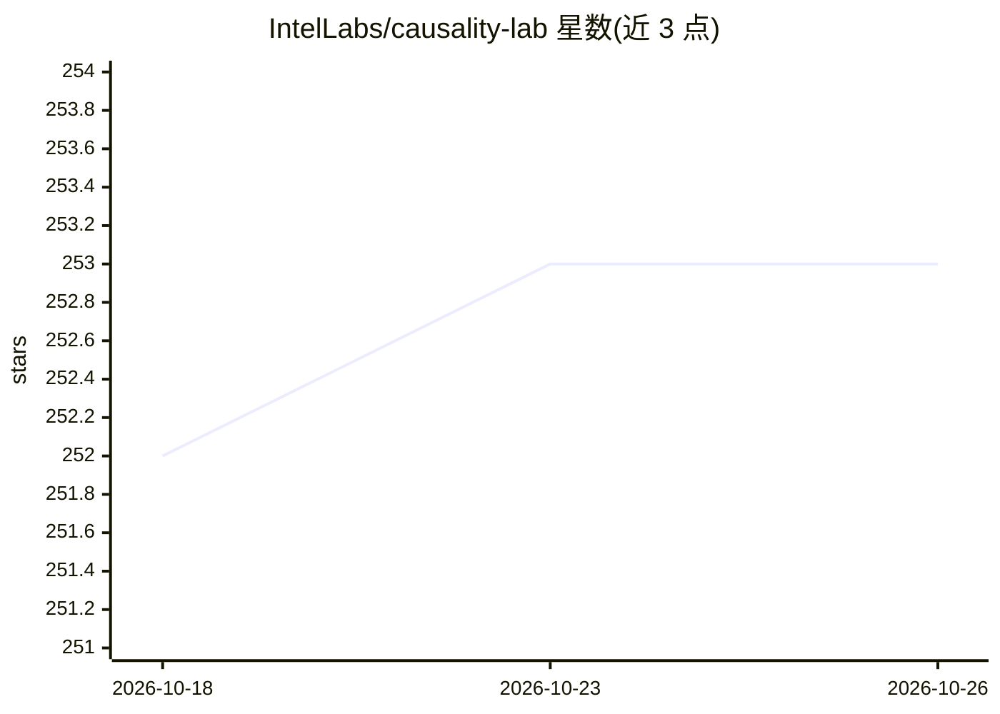

# IntelLabs/causality-lab

⭐ 253 · Jupyter Notebook · Apache-2.0 · 推送 2026-07-22 · [GitHub](https://github.com/IntelLabs/causality-lab) · 组织维护

**Intel Labs 因果发现与因果推理算法研究代码库**

由 Intel Labs 维护的 Python 研究代码库，包含其自研因果发现算法（ICD、OrdICD、TS-ICD、B-RAI、CLEANN 等）及 PC、FCI 等基线实现，可从观测数据学习因果结构（DAG/PAG 等图类），并提供随机 DAG 采样、观测数据生成、统计 CI 检验（条件互信息、偏相关、d-separation oracle）与结构准确性评估等工具，供研究者实现与评估新算法；新算法通过继承现有算法类并实现 learn_structure() 方法完成。要求 Python 3.10+，经 pip 从 GitHub 安装，属研究代码性质。

## 筛选速览

| 维度 | 判定 | 备注 |
|---|---|---|
| AI 角色 | `ai-native` | 本体是模型或模型工具 |
| 许可风险 | `permissive` | Apache-2.0 |
| 部署形态 | `library` | 以包/库形式分发 |
| 模型依赖 | — | README 未给出锁定关系 |
| 硬件要求 | — | 无带数字的原话,不猜 |
| 安装摩擦 | `low` | 无编译、无系统依赖或容器化 |
| 成熟度 | — | 结构信号不足 |

## 能力要点

- 三类算法：因果充分下结构学习、含隐混杂的因果发现、因果推理（如 CLEANN 从注意力生成解释）
- 提供 DAG/PDAG/UG/PAG-MAG 图类及遍历、属性计算与绘图
- 含数据模拟、CI 检验与结构准确性/计算成本评估的开发与评测工具
- 支持从预训练 GPT 注意力机制学习因果结构（OrdICD）

## 适用场景

- 从观测数据学习因果图并可视化
- 实现和评测新的因果结构学习算法
- 为预训练 BERT/GPT 模型输出基于注意力的因果解释

## 场景标签

 · 领域:因果机器学习/科研工具

## 证据(README 行号)

> L13: This repository contains research code for novel causal-discovery algorithms developed at Intel Labs, along with im
> L55: Included algorithms learn causal structures from observational data, and reason over learned causal graphs.

## 星数曲线

2026-10-18 252 → 2026-10-26 253（+1）

---
*卡片 v1 · prompt 1.4 · 生成 2026-10-22 · 置信度 high · 依据 README sha `1fd6b84ef0ea` · [字段定义](../../DATASET.md)*
