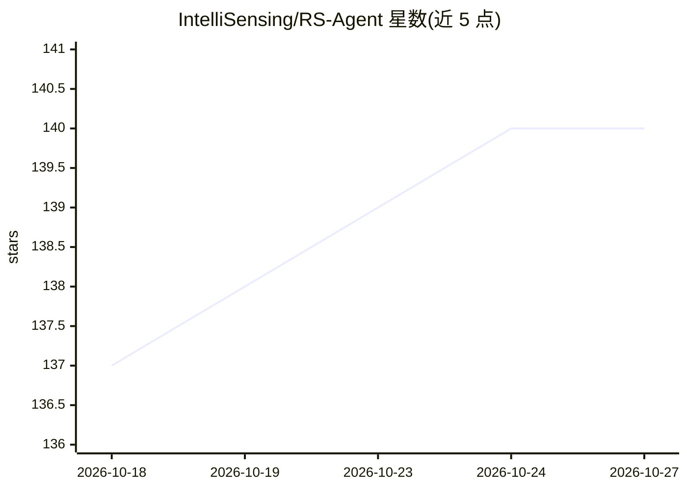

# IntelliSensing/RS-Agent

⭐ 140 · Python · Apache-2.0 · 推送 2026-08-26 · [GitHub](https://github.com/IntelliSensing/RS-Agent) · [官网](https://jarvis33yu.github.io/RS-Agent-website/) · 组织维护 · 中文 README

**面向遥感的 LLM 智能体：对话式完成遥感图像分析任务**

以北邮等机构研究团队维护的科研工作：LLM 作为 Central Controller，通过规划调用 18 个遥感工具（去云、超分、去噪、目标检测、场景分类、地物提取等），支持多轮对话与多工具组合；配合知识图谱增强的 RAG（DualRAG）检索领域知识，FAISS 索引存储专家任务方案。默认工具为占位 stub 仅供任务规划评测，真实推理需另行安装上游模型仓库；运行需配置 OpenAI 兼容 API key。论文默认骨干为 Qwen2.5-32B-Instruct。

## 筛选速览

| 维度 | 判定 | 备注 |
|---|---|---|
| AI 角色 | `ai-native` | 本体是模型或模型工具 |
| 许可风险 | `permissive` | Apache-2.0 |
| 部署形态 | `library` | 以包/库形式分发 |
| 模型依赖 | local-ok | 支持本地模型 |
| 硬件要求 | — | 无带数字的原话,不猜 |
| 安装摩擦 | `low` | 无编译、无系统依赖或容器化 |
| 成熟度 | — | 结构信号不足 |

## 能力要点

- LLM Central Controller 规划调用 18 个遥感处理工具
- 知识图谱增强 RAG（DualRAG/LightRAG）访问领域知识
- Solution Space 存储专家任务方案并通过任务感知检索引导规划
- 默认提供占位 stub 工具，真实推理需安装上游模型仓库

## 适用场景

- 通过多轮对话完成遥感图像去云、超分、检测等任务
- 复现论文中不同 LLM 骨干的任务规划评测
- 进行遥感领域专家级知识问答

## 场景标签

`图像视频处理` `科研工具` `模型评测` · 领域:评测与运维

## 证据(README 行号)

> L18: Recent advancements in Large Language Models (LLMs) and Multi-modal Large Language Models (MLLMs) have led to impre
> L22: 1. **Central Controller**: Serves as the decision-making core of the agent. It interprets user queries, plans task 
> L137: - **Stub tools by default**: Tools in `rs_agent/toolkit/stubs.py` return placeholder outputs for **task planning e

## 星数曲线

2026-10-18 137 → 2026-10-27 140（+3）

---
*卡片 v1 · prompt 1.4 · 生成 2026-10-23 · 置信度 high · 依据 README sha `2515aa484dcb` · [字段定义](../../DATASET.md)*
