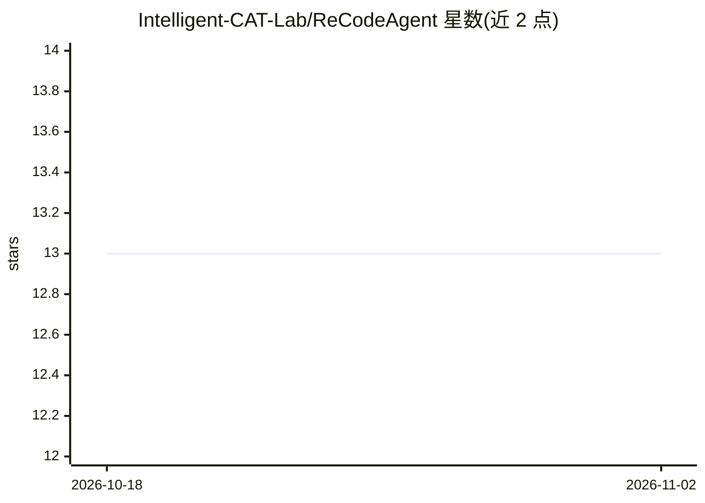

# Intelligent-CAT-Lab/ReCodeAgent

⭐ 13 · C · MIT · 推送 2026-10-08 · [GitHub](https://github.com/Intelligent-CAT-Lab/ReCodeAgent) · [官网](https://doi.org/10.5281/zenodo.19214481) · 组织维护

**多智能体框架：仓库级跨语言代码翻译与验证（ASE 2026 论文）**

ASE 2026 论文的 artifact 仓库。ReCodeAgent 结合静态分析与 LLM 智能体，通过 Analyzer/Planning/Translator/Validator 多智能体流程对整个代码仓库做跨语言翻译并验证功能等价性。主实验以 Claude Code（Sonnet，经 AWS Bedrock）为 LLM 智能体，可改接 OpenRouter 或在 model_utils.py 中配置其他智能体；支持 crust（C→Rust）、alphatrans（Java→Python）、skel（Python→JavaScript）、oxidizer（Go→Rust）四类翻译工具与语言对。提供 Dockerfile 与脚本复现 RQ1–RQ4 实验结果，Zenodo 存有翻译产物与轨迹。

## 筛选速览

| 维度 | 判定 | 备注 |
|---|---|---|
| AI 角色 | `ai-native` | 本体是模型或模型工具 |
| 许可风险 | `permissive` | MIT |
| 部署形态 | `self-host` | docker 或自建部署 |
| 模型依赖 | locked-api |  |
| 硬件要求 | — | 无带数字的原话,不猜 |
| 安装摩擦 | `low` | 无编译、无系统依赖或容器化 |
| 成熟度 | — | 结构信号不足 |

## 能力要点

- Analyzer/Planning/Translator/Validator 四类专职智能体协作流程
- 支持 4 种翻译工具与多语言对（C→Rust、Java→Python、Python→JS、Go→Rust）
- 默认 Claude Code + AWS Bedrock，可经 OpenRouter 接入开源模型
- Docker 构建安装全部依赖，脚本复现 RQ1–RQ4 实验结果

## 适用场景

- 复现论文的代码翻译与消融实验结果
- 在新的代码仓库上运行跨语言自动翻译并验证
- 扩展支持更多编程语言的翻译实验

## 场景标签

`多智能体` `代码生成` · 领域:Agent 开发

## 证据(README 行号)

> L11: ReCodeAgent is a language-agnostic framework for autonomous repository-level code translation and validation. It le
> L33: #### Claude Code

## 星数曲线

2026-10-18 13 → 2026-11-02 13（+0）

---
*卡片 v1 · prompt 1.4 · 生成 2026-10-31 · 置信度 high · 依据 README sha `4f3a77fcad4c` · [字段定义](../../DATASET.md)*
