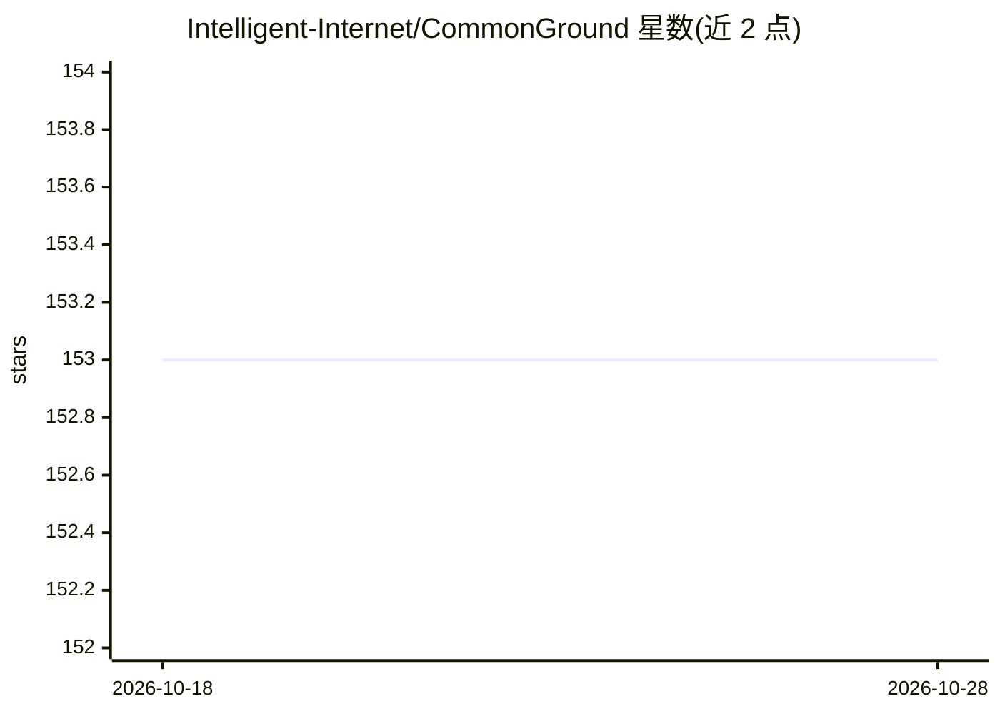

# Intelligent-Internet/CommonGround

⭐ 153 · Python · Apache-2.0 · 推送 2026-05-20 · [GitHub](https://github.com/Intelligent-Internet/CommonGround) · 组织维护 · 中文 README

**人机与多智能体协作的持久公共工作记录账本内核**

CommonGround Kernel 是一个开源的“账本内核”，为人-智能体与多智能体协作提供持久的公共工作底座：定义 Agent 身份、Turn 工作边界、Turn 持有的公共语义、claim 围栏与生命周期、因果谱系，以及基于拉取的账本与检查能力。它定位为 agent 运行时、记忆系统、编排框架之下的共享工作基底，不是记忆产品、编排框架或 agent 运行时本身。当前为 v3r1 初始开源预览版，与 v1 不兼容，支持 PostgreSQL 本地开发、uv 安装、CLI 优先工作流、BYOA 集成与可选 NanoBot 参考集成。

## 筛选速览

| 维度 | 判定 | 备注 |
|---|---|---|
| AI 角色 | `ai-ecosystem` | LLM/agent 周边工具 |
| 许可风险 | `permissive` | Apache-2.0 |
| 部署形态 | `library` | 以包/库形式分发 |
| 模型依赖 | — | README 未给出锁定关系 |
| 硬件要求 | — | 无带数字的原话,不猜 |
| 安装摩擦 | `low` | 无编译、无系统依赖或容器化 |
| 成熟度 | `idea` | |

## 能力要点

- Agent 身份、Turn 边界与 Turn 持有公共语义的账本内核
- claim 围栏与生命周期（claim/renew/suspend/resume/finish 等）
- 因果谱系与拉取优先的检查、审计与恢复
- CLI/HTTP 服务/Admin admission 流程与 BYOA、NanoBot 集成路径

## 适用场景

- 让独立 agent 与人通过持久公共记录跨会话交接工作
- 对 agent 工作过程留痕以供后续审计与复用
- 在自有 agent 框架之下接入统一的工作事实底座

## 场景标签

`多智能体` `Agent 记忆` · 领域:Agent 开发

## 证据(README 行号)

> L26: CommonGround is the shared work substrate underneath agent runtimes, memory systems, and orchestration frameworks.
> L40: In the v3r1 preview, that foundation is exposed as the **Ledger Kernel**: a small kernel for Agent identity, Turn l

## 星数曲线

2026-10-18 153 → 2026-10-28 153（+0）

---
*卡片 v1 · prompt 1.4 · 生成 2026-10-22 · 置信度 high · 依据 README sha `1de48bc06d9c` · [字段定义](../../DATASET.md)*
