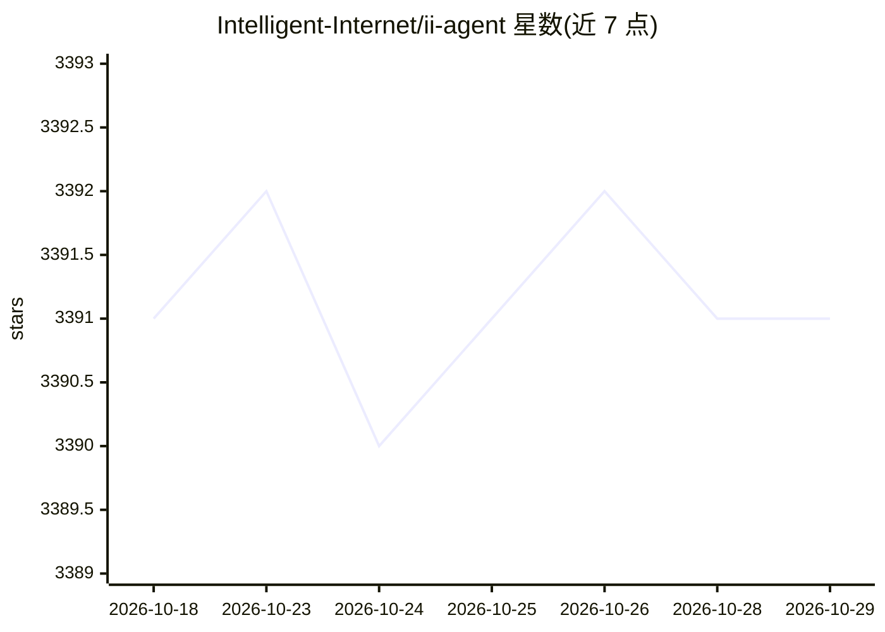

# Intelligent-Internet/ii-agent

⭐ 3,391 · Python · Apache-2.0 · 推送 2026-08-16 · [GitHub](https://github.com/Intelligent-Internet/ii-agent) · [官网](https://ii.inc/web/blog/post/ii-agent) · 组织维护

**开源 AI agent 框架：构建、部署并直接使用多模型智能体**

Apache-2.0 许可的开源 AI agent 项目，提供 Web 应用与框架本体。功能覆盖：从提示生成移动应用/网站/图文绘本、研究与深度研究并生成带引用的网站、多模型对话（可中途切换提供商）、文档/表格/幻灯片处理、计划模式与实时编辑，以及 Gmail/Slack/GitHub 等应用集成。采用 BYOK 模式，在 model_configs.yaml 或环境变量中配置 OpenAI/Anthropic/Google 等提供商（含 Vertex AI、Azure、自托管模型）。部署依赖 Docker、uv、Node.js，栈含 PostgreSQL、Redis、MinIO。

## 筛选速览

| 维度 | 判定 | 备注 |
|---|---|---|
| AI 角色 | `ai-ecosystem` | LLM/agent 周边工具 |
| 许可风险 | `permissive` | Apache-2.0 |
| 部署形态 | `self-host` | docker 或自建部署 |
| 模型依赖 | — | README 未给出锁定关系 |
| 硬件要求 | — | 无带数字的原话,不猜 |
| 安装摩擦 | `low` | 无编译、无系统依赖或容器化 |
| 成熟度 | — | 结构信号不足 |

## 能力要点

- 从提示生成移动应用、网站、绘本与幻灯片
- 多模型对话可在会话中途切换提供商，BYOK 自带密钥
- 支持 OpenAI/Anthropic/Google 及 Vertex AI、Azure、自托管模型
- Gmail、Slack、Notion、GitHub 等应用集成与自定义技能

## 适用场景

- 用单个提示生成完整网站或移动应用原型
- 执行多步深度研究并产出带引用的成果
- 企业内部搭建自托管的通用 AI agent 工具

## 场景标签

`Agent 框架` `AI 助手` · 领域:Agent 开发

## 证据(README 行号)

> L12: II-Agent is an open-source AI agent built for real work — now out of beta. 100% open source under the Apache-2.0 li
> L85: ### LLM Providers

## 星数曲线

2026-10-18 3,391 → 2026-10-29 3,391（+0）

---
*卡片 v1 · prompt 1.4 · 生成 2026-10-20 · 置信度 high · 依据 README sha `fa2c52d3999f` · [字段定义](../../DATASET.md)*
