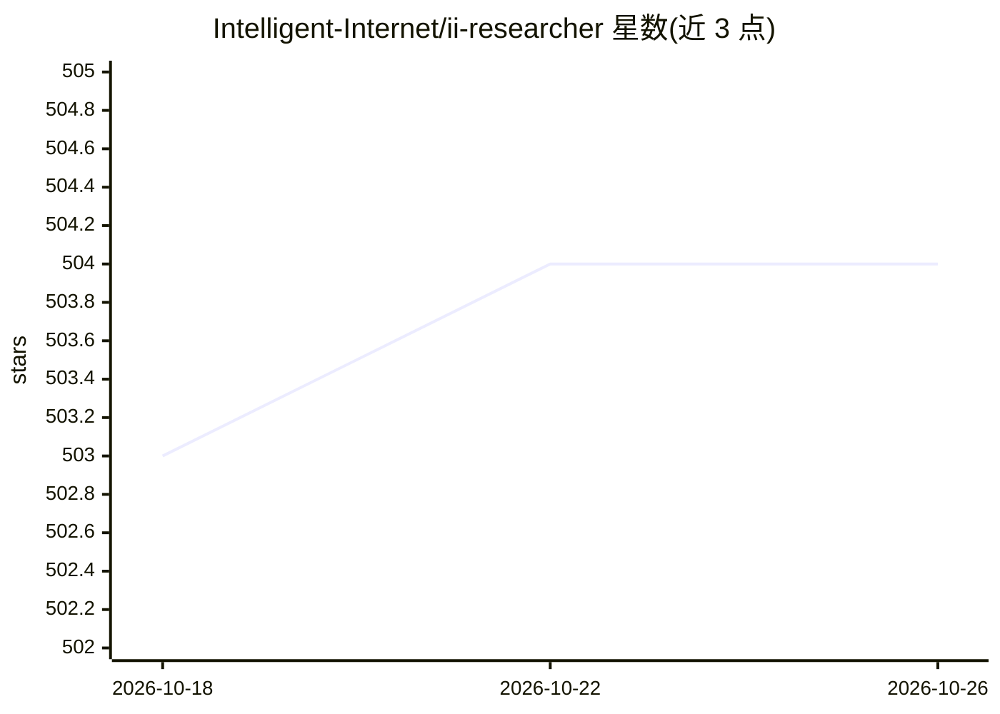

# Intelligent-Internet/ii-researcher

⭐ 504 · Python · Apache-2.0 · 推送 2026-07-02 · [GitHub](https://github.com/Intelligent-Internet/ii-researcher) · [官网](https://www.ii.inc/web/blog/post/ii-researcher) · 组织维护

**给研究者的深度搜索 agent：自动检索网页并产出带引用的报告**

Intelligent Internet 开发的开源深度搜索 agent：给定问题后自主搜索网页（Tavily/SerpAPI/Jina）、访问并读取页面（Firecrawl/无头浏览器等）、反思中间结果，最终生成带引用的综合报告。以 Python 库与 CLI、FastAPI 流式后端、Next.js Web UI、MCP 服务器四种形式交付，可自托管。模型经 LiteLLM 代理接入 OpenAI/DeepSeek/Gemini/OpenRouter 或自托管端点；支持嵌入与 LLM 两种上下文压缩。检索与抓取均需配置各服务商 API key，legacy 流水线模式已不再推荐。

## 筛选速览

| 维度 | 判定 | 备注 |
|---|---|---|
| AI 角色 | `ai-native` | 本体是模型或模型工具 |
| 许可风险 | `permissive` | Apache-2.0 |
| 部署形态 | `self-host` | docker 或自建部署 |
| 模型依赖 | — | README 未给出锁定关系 |
| 硬件要求 | — | 无带数字的原话,不猜 |
| 安装摩擦 | `low` | 无编译、无系统依赖或容器化 |
| 成熟度 | — | 结构信号不足 |

## 能力要点

- think–act–reflect 多步推理循环与 token 级流式输出
- 可插拔搜索（Tavily/SerpAPI/Jina）与抓取（Firecrawl/浏览器/BeautifulSoup 等）提供商，含 PDF 与 YouTube 处理
- 嵌入与 LLM 两种上下文压缩，控制在模型窗口内
- MCP 服务器一行接入 Claude Desktop 等 MCP 客户端

## 适用场景

- 对复杂问题自动检索多源网页并生成带引用的研究报告
- 在 Claude Desktop 等 MCP 客户端中调用作为研究工具
- 自托管部署一个带 Web UI 的深度搜索服务

## 场景标签

`科研工具` `网页抓取` · 领域:效率与自动化

## 证据(README 行号)

> L30: II-Researcher is a deep search agent built by Intelligent Internet. Given a question, it autonomously searches the 
> L32: It ships as a complete, self-hostable stack: a Python library and CLI, a streaming FastAPI backend, a Next.js web U
> L44: - 📝 **Referenced report generation** with selectable `basic` and `advanced` report types and multilingual support

## 星数曲线

2026-10-18 503 → 2026-10-26 504（+1）

---
*卡片 v1 · prompt 1.4 · 生成 2026-10-21 · 置信度 mid · 依据 README sha `a5e218a2bea9` · [字段定义](../../DATASET.md)*
