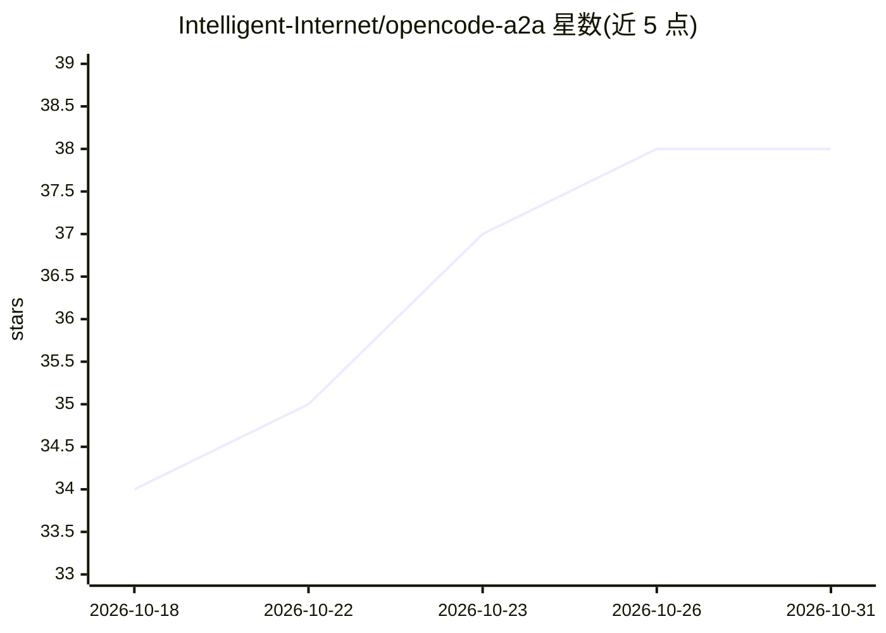

# Intelligent-Internet/opencode-a2a

⭐ 38 · Python · Apache-2.0 · 推送 2026-10-29 · [GitHub](https://github.com/Intelligent-Internet/opencode-a2a) · 组织维护

**将 OpenCode 接入 A2A 协议的适配服务**

基于 `opencode serve` 的 A2A 适配服务，在单进程中同时提供入站 A2A Server 与内嵌出站 A2A Client：对外暴露 `/message:send`、`/message:stream` 等 HTTP+JSON 与 JSON-RPC 端点，支持 A2A 1.0、SSE 流式输出、会话延续、请求级模型选择与 Bearer 静态认证；通过 `a2a_call` 工具实现出站 agent 间调用与多 agent 编排。运行需先启动 OpenCode 并配置 provider 凭据；不支持多租户隔离，持久化仅支持单进程配本地 SQLite，部署监督需自行携带（systemd/Docker/Kubernetes）。面向需要将 OpenCode 作为运行时并暴露为 A2A 服务的开发者，通过 uv tool 安装 CLI 使用。

## 筛选速览

| 维度 | 判定 | 备注 |
|---|---|---|
| AI 角色 | `ai-ecosystem` | LLM/agent 周边工具 |
| 许可风险 | `permissive` | Apache-2.0 |
| 部署形态 | `None` |  |
| 模型依赖 | — | README 未给出锁定关系 |
| 硬件要求 | — | 无带数字的原话,不猜 |
| 安装摩擦 | `low` | 无编译、无系统依赖或容器化 |
| 成熟度 | — | 结构信号不足 |

## 能力要点

- 单进程同时承担 A2A Server 与嵌入式 A2A Client（Peering Node）
- 支持 A2A 1.0 的 HTTP+JSON、JSON-RPC、Agent Card 发现与 SSE 流式输出
- `a2a_call` 工具支持出站 agent 间调用，结果作为工具结果返回模型
- 会话延续（metadata.shared.session.id）与请求级模型选择

## 适用场景

- 把 OpenCode 编程 agent 暴露为 A2A 协议服务供外部客户端或网关调用
- 通过 CLI 或 a2a_call 工具与其他 A2A agent 交互做多 agent 编排
- 在 OpenCode 前加一层带认证与服务边界的 A2A 适配层

## 场景标签

`多智能体` · 领域:Agent 开发

## 证据(README 行号)

> L14: `opencode-a2a` adds an A2A runtime layer to `opencode serve`, with auth, streaming, session continuity, interrupt h
> L18: - An A2A adapter service built on `opencode serve`, with inbound runtime exposure plus outbound peer calling.
> L19: - It supports both roles in one process: serving as an A2A Server and hosting an embedded A2A Client for `a2a_call`

## 星数曲线

2026-10-18 34 → 2026-10-31 38（+4）

---
*卡片 v1 · prompt 1.4 · 生成 2026-10-25 · 置信度 high · 依据 README sha `d7a82aa9acfe` · [字段定义](../../DATASET.md)*
