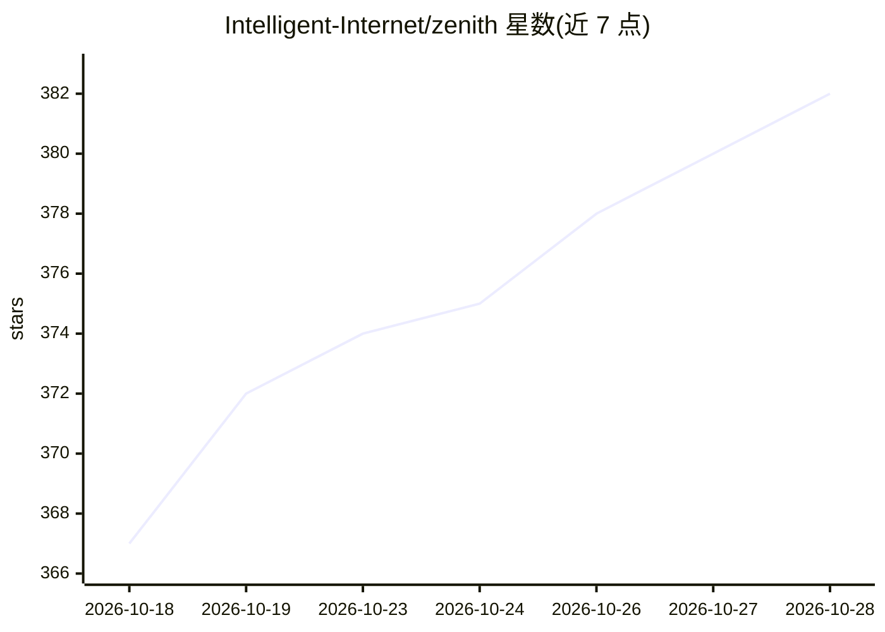

# Intelligent-Internet/zenith

⭐ 382 · Python · Apache-2.0 · 推送 2026-09-06 · [GitHub](https://github.com/Intelligent-Internet/zenith) · 组织维护

**长时任务的持续改进型 agent 编排框架（harness）**

将 Claude Code、Codex 或 Hermes 等编码 agent 转变为多 agent 任务编排器：单一 orchestrator 会话每回合读取任务状态，决定是否派生 worker/tester 子 agent、注册可复用技能、重规划或停止，通过 MCP/ACP 通信。设计目标是应对长周期任务中的'过早完成'失败模式，附技术报告与八项长时任务消融实验。以 Python 包（zenith-harness）与 CLI 形式提供，需 Python 3.11+、uv、Node.js 22+ 及至少一种受支持的编码 agent。

## 筛选速览

| 维度 | 判定 | 备注 |
|---|---|---|
| AI 角色 | `ai-ecosystem` | LLM/agent 周边工具 |
| 许可风险 | `permissive` | Apache-2.0 |
| 部署形态 | `library` | 以包/库形式分发 |
| 模型依赖 | locked-api |  |
| 硬件要求 | — | 无带数字的原话,不猜 |
| 安装摩擦 | `low` | 无编译、无系统依赖或容器化 |
| 成熟度 | — | 结构信号不足 |

## 能力要点

- orchestrator 每回合决策：派生 worker/tester、注册技能、重规划或停止
- 通过 MCP/ACP 将单一编码 agent 运行为多 agent 编排
- 针对八项长时任务的消融实验与基准结果
- 可由 Claude Code/Codex 自动安装并创建 /zenith 技能

## 适用场景

- 让编码 agent 承接可能运行数天到数周的长周期任务
- 在软件工程任务中引入独立验证与重规划机制
- 研究长时 agent 的停止策略与编排机制

## 场景标签

`多智能体` `编码 Agent` `Agent 框架` · 领域:Agent 开发

## 证据(README 行号)

> L10: Zenith is an agent harness for work that may run for days or weeks, where the dominant failure mode is *premature c
> L110: A single orchestrator session reads task state each turn and decides what to do next: spawn worker or tester subag

## 星数曲线

2026-10-18 367 → 2026-10-28 382（+15）

---
*卡片 v1 · prompt 1.4 · 生成 2026-10-22 · 置信度 mid · 依据 README sha `f2e090350bd6` · [字段定义](../../DATASET.md)*
