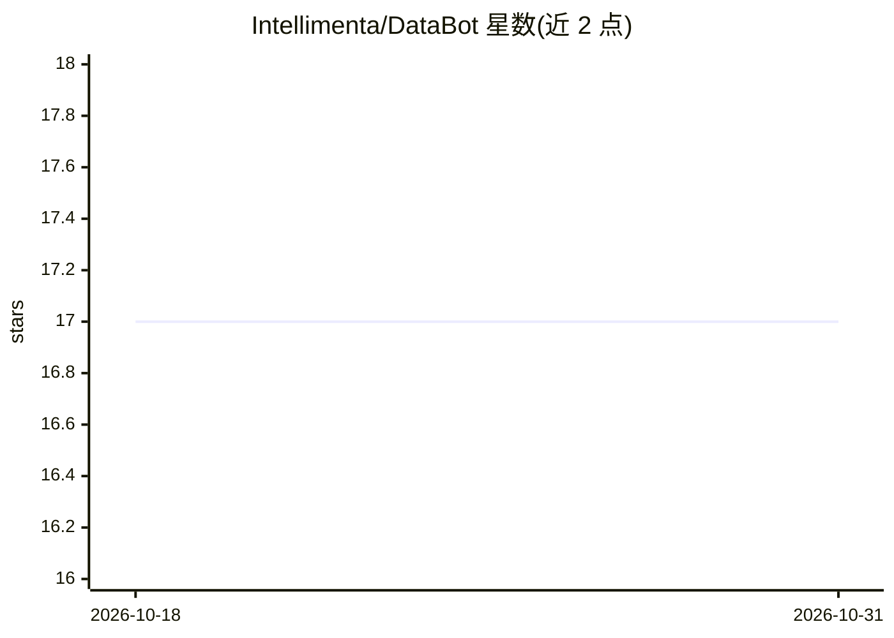

# Intellimenta/DataBot

⭐ 17 · JavaScript · 推送 2026-04-05 · [GitHub](https://github.com/Intellimenta/DataBot) · [官网](https://intellimenta.com/products/databot) · 组织维护

**自托管的数据分析 AI 助手：自然语言问答、可视化与报表**

面向数据分析场景的自托管 AI 助手，用户用自然语言提问，系统生成分析、可视化、报表与预测。通过 text-to-SQL 机制对接主流 SQL/NoSQL 数据库与 BI 工具（当前支持 Metabase），执行前做 SQL 校验，失败时将错误回传 LLM 自我修正，并有 SELECT-only 等安全护栏。安全特性包括动态数据脱敏、RBAC、行级安全、SSO 与多租户，可嵌入网站或应用。个人使用免费。

## 筛选速览

| 维度 | 判定 | 备注 |
|---|---|---|
| AI 角色 | `ai-native` | 本体是模型或模型工具 |
| 许可风险 | `none` | — |
| 部署形态 | `self-host` | docker 或自建部署 |
| 模型依赖 | — | README 未给出锁定关系 |
| 硬件要求 | — | 无带数字的原话,不猜 |
| 安装摩擦 | `low` | 无编译、无系统依赖或容器化 |
| 成熟度 | — | 结构信号不足 |

## 能力要点

- text-to-SQL 带执行前校验与失败自动修正循环
- 动态数据脱敏、RBAC、行级安全、SSO 等访问控制
- 支持主流 SQL/NoSQL 数据库与 Metabase 仪表盘数据源
- 可嵌入网站或应用（如 Salesforce）

## 适用场景

- 对自有数据库用自然语言做探查和可视化
- 生成报表与预测并嵌入业务系统
- 在多租户、需行级权限控制的团队内安全使用

## 场景标签

`数据分析` `AI 助手` · 领域:效率与自动化

## 证据(README 行号)

> L6: - With DataBot, you can ask analytical questions, create visualizations, generate reports and produce forecasts, all
> L37: - 🔄 Self-correction loop (if SQL fails, the error is sent back to the LLM for auto-correction)

## 星数曲线

2026-10-18 17 → 2026-10-31 17（+0）

---
*卡片 v1 · prompt 1.4 · 生成 2026-10-30 · 置信度 high · 依据 README sha `42b719fb7944` · [字段定义](../../DATASET.md)*
