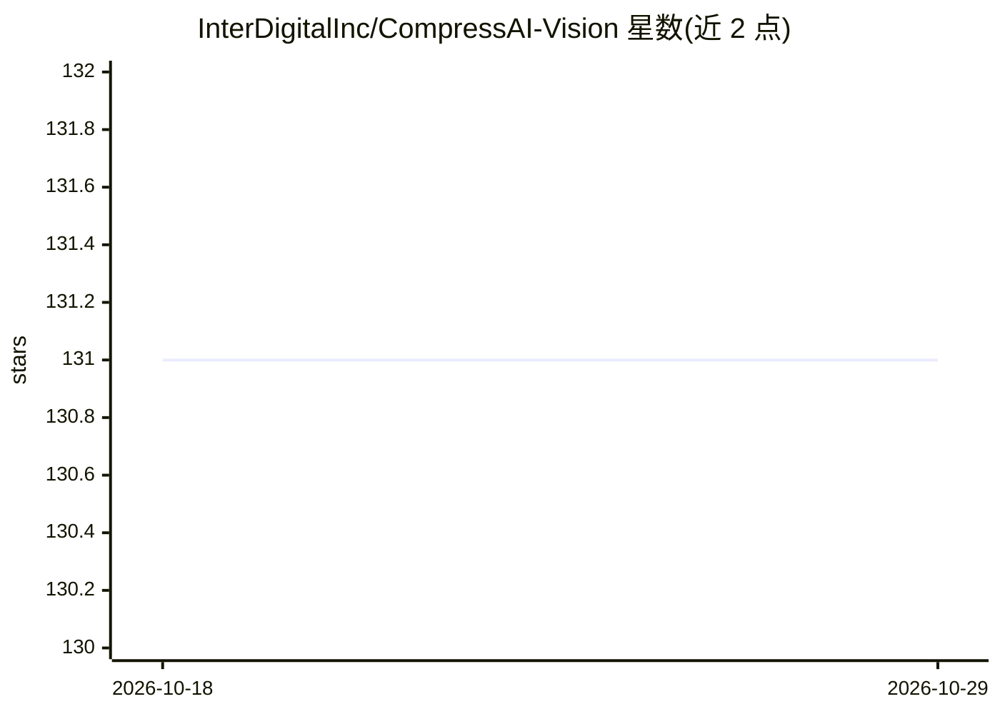

# InterDigitalInc/CompressAI-Vision

⭐ 131 · Python · BSD-3-Clause-Clear · 推送 2026-10-08 · [GitHub](https://github.com/InterDigitalInc/CompressAI-Vision) · [官网](https://interdigitalinc.github.io/CompressAI-Vision/) · 组织维护

**面向机器任务的视觉/视频压缩评测框架（VCM/FCM）**

由 InterDigital 团队维护的开源评测框架，用于设计、测试和比较面向机器视觉任务的压缩流水线：对应 MPEG VCM 的远程推理（compressai-remote-inference）与对应 MPEG FCM 的分割推理特征压缩评测（compressai-split-inference）。压缩方法可来自 CompressAI 的学习型模块或 H.266/VVC 等传统编解码器；内置 Detectron2、JDE、YOLOX、RTMO、SAM/SAM2 等视觉模型支持，通过脚本安装依赖与权重，附带 MPEG FCM 测试数据与配置示例。限制：SAM2 需 python>=3.10/torch>=2.5.1，与 FCM-CTTC 配置可能不兼容。

## 筛选速览

| 维度 | 判定 | 备注 |
|---|---|---|
| AI 角色 | `ai-ecosystem` | LLM/agent 周边工具 |
| 许可风险 | `viral` | BSD-3-Clause-Clear |
| 部署形态 | `library` | 以包/库形式分发 |
| 模型依赖 | — | README 未给出锁定关系 |
| 硬件要求 | — | 无带数字的原话,不猜 |
| 安装摩擦 | `medium` | 含编译或系统依赖之一 |
| 成熟度 | — | 结构信号不足 |

## 能力要点

- 覆盖 MPEG VCM 与 FCM 两类流水线的标准化评测
- 支持学习型压缩（CompressAI 子模块）与传统编解码（H.266/VVC）
- 内置 Detectron2/JDE/YOLOX/RTMO/SAM/SAM2 等机器视觉任务模型
- 提供 CLI 入口、配置示例与 MPEG FCM 测试数据

## 适用场景

- 评测面向检测/分割等机器任务的视频压缩流水线
- 在 MPEG VCM/FCM 标准活动框架下做实验对比
- 压缩分割推理中间特征并评估任务性能损失

## 场景标签

`模型评测` · 领域:评测与运维

## 证据(README 行号)

> L3: CompressAI-Vision helps you to develop, test and evaluate compression models with standardized tests in the context 
> L7: - Video compression for remote inference (`compressai-remote-inference`), which corresponds to the MPEG "Video Codin
> L9: - Split inference (`compressai-split-inference`), which includes an evaluation framework for compressing intermediat

## 星数曲线

2026-10-18 131 → 2026-10-29 131（+0）

---
*卡片 v1 · prompt 1.4 · 生成 2026-10-22 · 置信度 mid · 依据 README sha `782f150fecdd` · [字段定义](../../DATASET.md)*
