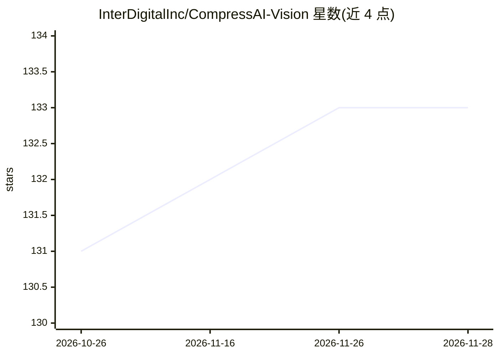

# InterDigitalInc/CompressAI-Vision

⭐ 133 · Python · BSD-3-Clause-Clear · 推送 2026-11-17 · [GitHub](https://github.com/InterDigitalInc/CompressAI-Vision) · [官网](https://interdigitalinc.github.io/CompressAI-Vision/) · 组织维护

**面向机器视觉任务的压缩评测框架：设计、测试与比较 VCM/FCM 管线**

面向机器任务优化的视频压缩评测软件，聚焦两类管线：远程推断（对应 MPEG Video Coding for Machines 活动）与分割推断（含中间特征压缩评测，支持 MPEG FCM 活动定义的全部管线）。集成 Detectron2、YOLOX、JDE、MMPOSE、SAM/SAM2、torchvision 等视觉模型用于目标检测、跟踪、姿态估计与分割，压缩模块来自 CompressAI 子模块或 H.266/VVC 等传统编码器。通过 venv+pip、uv 或 install.sh 脚本安装，提供 CLI 入口与配置示例，遵循 BSD 3-Clause Clear 许可，附 arXiv 论文引用。

## 筛选速览

| 维度 | 判定 | 备注 |
|---|---|---|
| AI 角色 | `ai-ecosystem` | LLM/agent 周边工具 |
| 许可风险 | `viral` | BSD-3-Clause-Clear |
| 部署形态 | `library` | 以包/库形式分发 |
| 模型依赖 | — | README 未给出锁定关系 |
| 硬件要求 | — | 无带数字的原话,不猜 |
| 安装摩擦 | `medium` | 含编译或系统依赖之一 |
| 成熟度 | — | 结构信号不足 |

## 能力要点

- 支持远程推断与分割推断两类管线，对应 MPEG VCM/FCM 标准化测试
- 集成 Detectron2、YOLOX、JDE、MMPOSE、SAM2、EfficientViT-SAM 等视觉模型
- 压缩方法可来自 CompressAI 学习式模块或 H.266/VVC 传统编码器
- 提供 CLI 入口、./cfgs 配置示例与 MPEG FCM 测试数据

## 适用场景

- 按 MPEG VCM/FCM 测试条件评测面向机器任务的压缩方法
- 比较学习式压缩与传统编码器在检测/分割等任务下的表现
- 搭建分割推断管线并压缩中间特征

## 场景标签

`模型评测` `图像视频处理` · 领域:评测与运维

## 证据(README 行号)

> L3: CompressAI-Vision helps you to develop, test and evaluate compression models with standardized tests in the context 
> L9: - Split inference (`compressai-split-inference`), which includes an evaluation framework for compressing intermediat
> L35: A complete documentation is provided here, including installation, CLI usage, as well as tutorials.

## 星数曲线

2026-10-26 131 → 2026-11-28 133（+2）

---
*卡片 v1 · prompt 1.4 · 生成 2026-11-28 · 置信度 high · 依据 README sha `6da2f38c192c` · [字段定义](../../DATASET.md)*
