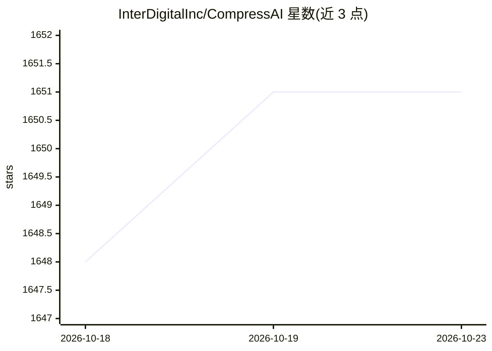

# InterDigitalInc/CompressAI

⭐ 1,651 · Python · BSD-3-Clause-Clear · 推送 2026-10-08 · [GitHub](https://github.com/InterDigitalInc/CompressAI) · [官网](https://interdigitalinc.github.io/CompressAI/) · 组织维护

**基于 PyTorch 的端到端压缩研究库与评测平台**

面向压缩研究的 PyTorch 库与评测平台：提供深度学习数据压缩所需的自定义算子、层与模型，TensorFlow compression 库的部分移植，学习型图像压缩预训练模型，以及对比学习模型与传统图像/视频编解码器（BPG、VTM、x265 等）的评测脚本。附编码/解码、训练、评测的示例脚本与 notebook，支持多 GPU 分布式训练（实验性）。需 Python 3.8+ 与 PyTorch 1.7+，源码安装需 C++17 编译器。

## 筛选速览

| 维度 | 判定 | 备注 |
|---|---|---|
| AI 角色 | `ai-native` | 本体是模型或模型工具 |
| 许可风险 | `viral` | BSD-3-Clause-Clear |
| 部署形态 | `library` | 以包/库形式分发 |
| 模型依赖 | — | README 未给出锁定关系 |
| 硬件要求 | — | 无带数字的原话,不猜 |
| 安装摩擦 | `medium` | 含编译或系统依赖之一 |
| 成熟度 | `idea` | |

## 能力要点

- 深度学习压缩的自定义算子、层与模型
- 学习型图像压缩预训练模型（model zoo）
- 评测脚本对比学习模型与传统编解码器（BPG/VTM/x265 等）
- 支持多 GPU 分布式训练（实验性）

## 适用场景

- 用预训练模型对图像进行学习型压缩编解码
- 训练自己的端到端压缩模型并做率失真评测
- 将学习模型与传统图像/视频编解码器做性能对比

## 场景标签

 · 领域:机器学习/数据压缩

## 证据(README 行号)

> L5: CompressAI (_compress-ay_) is a PyTorch library and evaluation platform for
> L10: * custom operations, layers and models for deep learning based data compression

## 星数曲线

2026-10-18 1,648 → 2026-10-23 1,651（+3）

---
*卡片 v1 · prompt 1.4 · 生成 2026-10-21 · 置信度 high · 依据 README sha `27b170364680` · [字段定义](../../DATASET.md)*
