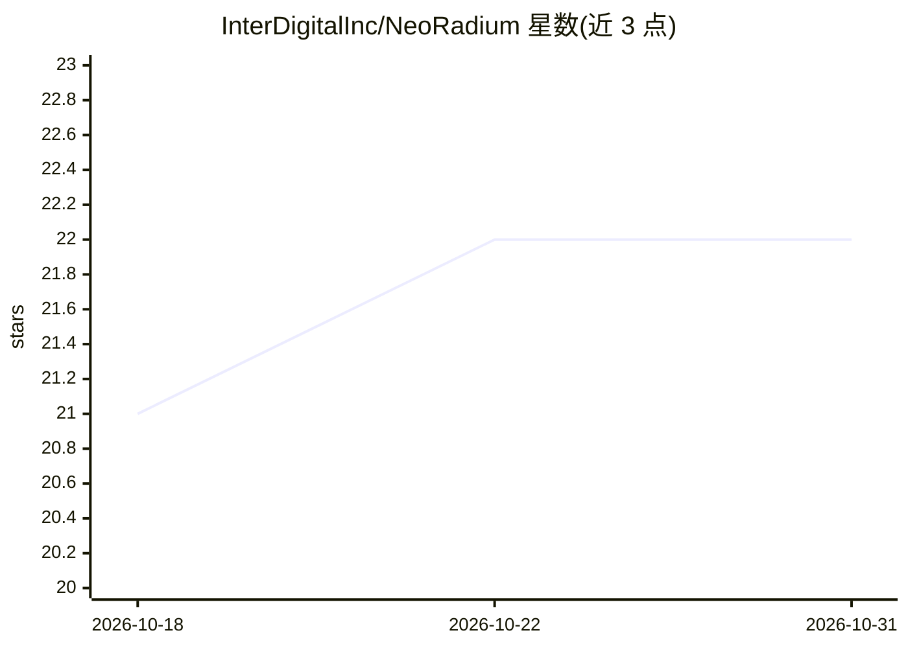

# InterDigitalInc/NeoRadium

⭐ 22 · Jupyter Notebook · NOASSERTION · 推送 2026-09-11 · [GitHub](https://github.com/InterDigitalInc/NeoRadium) · [官网](https://interdigitalinc.github.io/NeoRadium/) · 组织维护

**3GPP 5G NR 物理层端到端仿真 Python 库**

面向研究人员与工程师的无线通信仿真库：基于 3GPP 5G NR 标准，以面向对象设计抽象物理层建模复杂度，支持信道估计、均衡、预编码、波束管理、调度、信道编码等组件的构建与评估，并提供完整可互操作的端到端系统。可在普通桌面/笔记本电脑上运行，无需专用硬件或 GPU，要求 Python 3.10+。附带含教程与示例的 Playground（Jupyter Notebook）。

## 筛选速览

| 维度 | 判定 | 备注 |
|---|---|---|
| AI 角色 | `ai-enhanced` | 去掉 AI 部分产品仍成立 |
| 许可风险 | `none` | NOASSERTION |
| 部署形态 | `None` |  |
| 模型依赖 | — | README 未给出锁定关系 |
| 硬件要求 | — | 无带数字的原话,不猜 |
| 安装摩擦 | `low` | 无编译、无系统依赖或容器化 |
| 成熟度 | — | 结构信号不足 |

## 能力要点

- 基于 3GPP 5G NR 标准的物理层仿真框架
- 支持单独评估信道估计/均衡/预编码/调度等组件并可接入完整端到端系统
- 无需专用硬件或 GPU，Python 3.10+ 即可运行
- Playground 提供 Jupyter Notebook 教程与示例

## 适用场景

- 研究人员评估单个物理层算法而无需自行实现完整标准流程
- 构建端到端 5G NR 通信仿真
- 通过 Notebook 教程学习物理层 API 与概念

## 场景标签

`教程课程` · 领域:学习与行业

## 证据(README 行号)

> L7: **NeoRadium** is a Python library for simulating end-to-end wireless communication systems based on the latest **3GP
> L13: **NeoRadium** is designed to run on standard desktop and laptop computers without requiring specialized hardware, c

## 星数曲线

2026-10-18 21 → 2026-10-31 22（+1）

---
*卡片 v1 · prompt 1.4 · 生成 2026-10-27 · 置信度 low · 依据 README sha `f2e6f86b7921` · [字段定义](../../DATASET.md)*
