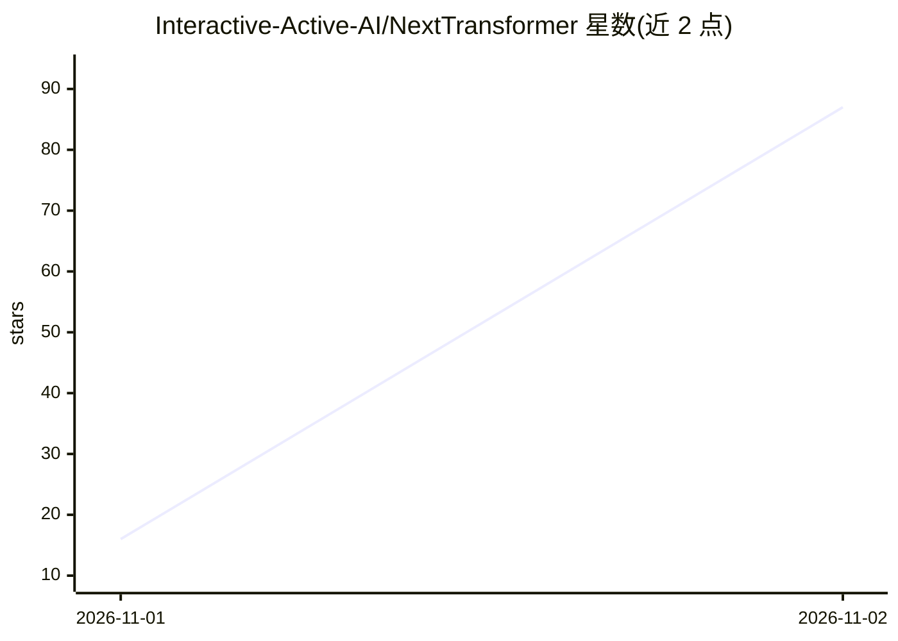

# Interactive-Active-AI/NextTransformer

⭐ 87 · Python · MIT · 推送 2026-11-01 · [GitHub](https://github.com/Interactive-Active-AI/NextTransformer) · [官网](https://interactive-active-ai.github.io/NextTransformer/) · 组织维护 · 中文 README

**面向下一代 Transformer 架构的统一训练基准与自动化研究平台**

在相同数据（ClimbMix 定版）、相同 49.152B token、相同理论 FLOPs 预算下训练稠密/稀疏/线性注意力、循环深度、残差流及其混合架构，并在相同检查点评估，产出可审计的文件级记录与排行榜。提供模型动物园（31 个运行、36 张模型卡）、观测台（学习曲线、22 项 CORE 任务）、插件式新增方法流程，以及计划于 2026-11-14 发布的 Arena v2 自主 agent 研究环境。Linux+NVIDIA GPU 环境，单机 8 卡约 2-4 天完成 1.4B 模型预训练。

## 筛选速览

| 维度 | 判定 | 备注 |
|---|---|---|
| AI 角色 | `ai-ecosystem` | LLM/agent 周边工具 |
| 许可风险 | `permissive` | MIT |
| 部署形态 | `library` | 以包/库形式分发 |
| 模型依赖 | — | README 未给出锁定关系 |
| 硬件要求 | — | 无带数字的原话,不猜 |
| 安装摩擦 | `low` | 无编译、无系统依赖或容器化 |
| 成熟度 | `idea` | |

## 能力要点

- 计算匹配协议：预算偏差 ±1% 入场、±2% 全程审计
- 模型动物园覆盖 Looped/Sparse/Linear/Hybrid 等 7 类架构
- 插件式接入新方法：plugin + calibrate + PR 两步提交流程
- Arena v2 规划 MCP 工具、计量算力与自主研究循环（开发中）

## 适用场景

- 在公平预算下对比不同 Transformer 变体的训练效果
- 研究人员将自己的注意力/循环架构以插件形式提交并上榜
- 让 LLM agent 在同一规则下自动探索新架构

## 场景标签

`模型评测` `模型训练` · 领域:评测与运维

## 证据(README 行号)

> L18: **When the training budget is fixed, how should a language model spend its computation?** NextTransformer trains
> L21: result is an audited, file-backed record, and AI agents can research new architectures under the very same rules.
> L33: A fair, explicit protocol: same data, tokens, optimizer, schedule and evaluation for every model; training compute 

## 星数曲线

2026-11-01 16 → 2026-11-02 87（+71）

---
*卡片 v1 · prompt 1.4 · 生成 2026-10-31 · 置信度 mid · 依据 README sha `11e21b276dca` · [字段定义](../../DATASET.md)*
