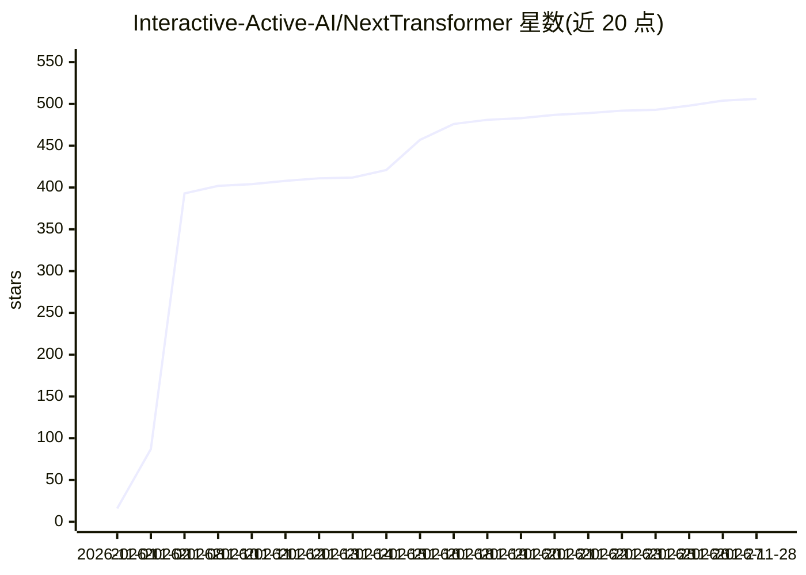

# Interactive-Active-AI/NextTransformer

⭐ 506 · Python · MIT · 推送 2026-11-27 · [GitHub](https://github.com/Interactive-Active-AI/NextTransformer) · [官网](https://interactive-active-ai.github.io/NextTransformer/) · 组织维护 · 中文 README

**新一代 Transformer 架构的公平基准与自研研究框架**

开源框架与基准平台：在同一数据（49.152B tokens）、相同训练 FLOPs（±1% 审计）下训练与评测循环深度、稀疏/线性注意力、残差流变体及混合架构，结果以文件化记录落盘。支持多节点/Slurm 分布式训练，提供观测站（学习曲线、排行榜、模型卡片）与 Arena v2——带 MCP 工具与计量算力的 agent 自主架构研究环境。要求 Python 3.10–3.13、PyTorch 2.9.1、NVIDIA GPU，数据集约 600 GB，训练门槛较高。

## 筛选速览

| 维度 | 判定 | 备注 |
|---|---|---|
| AI 角色 | `ai-native` | 本体是模型或模型工具 |
| 许可风险 | `permissive` | MIT |
| 部署形态 | `library` | 以包/库形式分发 |
| 模型依赖 | — | README 未给出锁定关系 |
| 硬件要求 | — | 无带数字的原话,不猜 |
| 安装摩擦 | `low` | 无编译、无系统依赖或容器化 |
| 成熟度 | — | 结构信号不足 |

## 能力要点

- 同一算力匹配协议下对比多种 Transformer 架构（GQA、NSA、MoBA、GDN、KDA、Ouro 等）
- Arena v2：agent 可通过 MCP 工具与计量算力自主提交架构研究
- 观测站提供学习曲线、排行榜、22 个 CORE 任务与模型卡片
- 模型权重发布于 Hugging Face 组织

## 适用场景

- 在固定训练预算下对比不同注意力/残差架构的语言模型表现
- 让 LLM agent 在统一协议下自主研究并提交新架构
- 按协议插件化提交自己的模型方法到排行榜

## 场景标签

`模型评测` · 领域:评测与运维

## 证据(README 行号)

> L22: **When the training budget is fixed, how should a language model spend its computation?** NextTransformer trains
> L25: result is an audited, file-backed record, and AI agents can research new architectures under the very same rules.
> L178: > **Arena v2 is live.** Autonomous agent research is supported end to end: a research gym with MCP

## 星数曲线

2026-11-01 16 → 2026-11-28 506（+490）

---
*卡片 v1 · prompt 1.4 · 生成 2026-11-28 · 置信度 mid · 依据 README sha `a7c2235318ad` · [字段定义](../../DATASET.md)*
