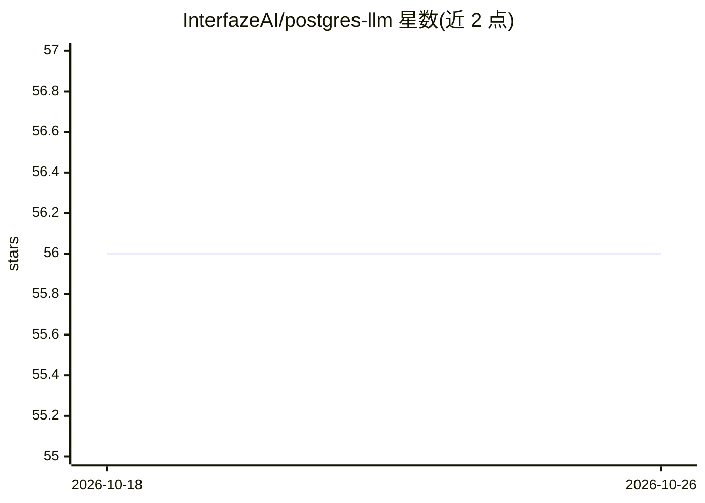

# InterfazeAI/postgres-llm

⭐ 56 · PLpgSQL · 推送 2026-05-06 · [GitHub](https://github.com/InterfazeAI/postgres-llm) · [官网](https://interfaze.ai/blog/run-llms-inside-postgres) · 组织维护

**在 Postgres 内直接调用 LLM 的触发器函数，自动填充指定列**

以 SQL 脚本形式提供的 Postgres 触发器函数：行插入或更新时将 LLM 任务入队到 llm.queue，由 pg_cron worker 异步调用任意 Chat completion API 兼容的模型，用 JSON schema 结构化输出确保结果按目标列名返回并自动更新多个列。提示词支持 {column_name} 占位符引用同行其他列的值，内置可配置次数的重试逻辑。面向需要数据库内翻译、情感分析、摘要、OCR 等场景的开发者。依赖 http、hstore、pg_cron 三个扩展，默认指向 Interfaze，可替换 API_KEY/BASE_URL/MODEL_NAME。

## 筛选速览

| 维度 | 判定 | 备注 |
|---|---|---|
| AI 角色 | `ai-native` | 本体是模型或模型工具 |
| 许可风险 | `none` | — |
| 部署形态 | `None` |  |
| 模型依赖 | — | README 未给出锁定关系 |
| 硬件要求 | — | 无带数字的原话,不猜 |
| 安装摩擦 | `low` | 无编译、无系统依赖或容器化 |
| 成熟度 | — | 结构信号不足 |

## 能力要点

- 触发器入队 + pg_cron 异步执行，INSERT 立即返回
- 兼容任意 Chat completion API（可替换 BASE_URL/API_KEY/MODEL_NAME）
- 提示词支持 {column_name} 占位符引用同行列值，单次调用可更新多列
- JSON schema 结构化输出与内置重试逻辑

## 适用场景

- 用户评论入库后自动做情感分析并写入指定列
- 新增文本时自动生成多语言翻译列
- 对行内图片 URL 自动执行 OCR 提取文本

## 场景标签

`OCR` · 领域:感知与多模态

## 证据(README 行号)

> L5: A dynamic Postgres trigger function that runs an LLM request directly in your database for use cases like translatio
> L9: - Async execution - non-blocking, model runs async
> L10: - Use any Chat completion API compatible LLM
> L73: The function uses JSON schema structured output (`response_format` with `type: json_schema`) to ensure the LLM retu

## 星数曲线

2026-10-18 56 → 2026-10-26 56（+0）

---
*卡片 v1 · prompt 1.4 · 生成 2026-10-24 · 置信度 high · 依据 README sha `2143ab07b69a` · [字段定义](../../DATASET.md)*
