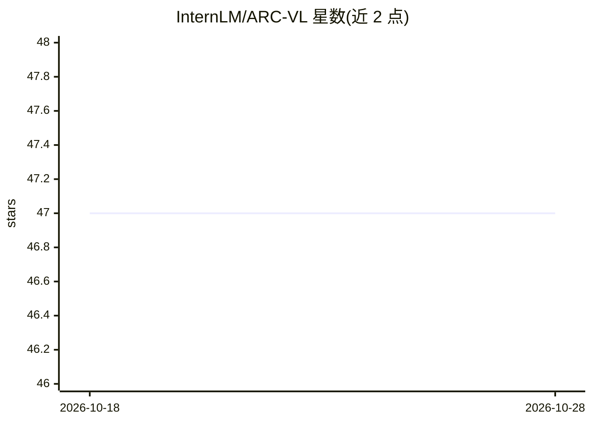

# InternLM/ARC-VL

⭐ 47 · Python · Apache-2.0 · 推送 2025-11-26 · [GitHub](https://github.com/InternLM/ARC-VL) · [官网](https://arxiv.org/pdf/2511.15703) · 组织维护 · 中文 README

**ARC-AGI 任务的视觉-语言协同推理方法官方实现（CVPR 2026 论文）**

论文《Think Visually, Reason Textually: Vision-Language Synergy in ARC》的官方推理代码。面向科研人员，将视觉智能引入 ARC-AGI 推理：通过 VLSR 把任务分解为模态对齐子任务，用 MSSC 借视觉验证文本推理实现自我纠错。提供推理与评分脚本，需配置外部模型 API key（如 GPT-4o），自行下载 ARC-AGI/BARC/Re-ARC 数据集。代码仅限研究用途许可。

## 筛选速览

| 维度 | 判定 | 备注 |
|---|---|---|
| AI 角色 | `ai-native` | 本体是模型或模型工具 |
| 许可风险 | `permissive` | Apache-2.0 |
| 部署形态 | `library` | 以包/库形式分发 |
| 模型依赖 | — | README 未给出锁定关系 |
| 硬件要求 | — | 无带数字的原话,不猜 |
| 安装摩擦 | `low` | 无编译、无系统依赖或容器化 |
| 成熟度 | — | 结构信号不足 |

## 能力要点

- VLSR 将 ARC-AGI 分解为模态对齐子任务
- MSSC 利用视觉验证文本推理进行纠错
- 提供 inference.py 与 score.py 推理评分脚本

## 适用场景

- 在 ARC-AGI/BARC/Re-ARC 数据集上复现论文推理结果
- 对比不同模型视觉思考与文本思考的输出表现
- 基于视觉-语言协同策略开展推理研究

## 场景标签

`科研工具` · 领域:学习与行业

## 证据(README 行号)

> L25: We integrate Visual Intelligence into ARC-AGI to leverage the respective advantages of vision and text: vision supp
> L28: (1) Vision-Language Synergy Reasoning (VLSR) which decomposes ARC-AGI into modality-aligned subtasks; and

## 星数曲线

2026-10-18 47 → 2026-10-28 47（+0）

---
*卡片 v1 · prompt 1.4 · 生成 2026-10-25 · 置信度 mid · 依据 README sha `3253a341b936` · [字段定义](../../DATASET.md)*
