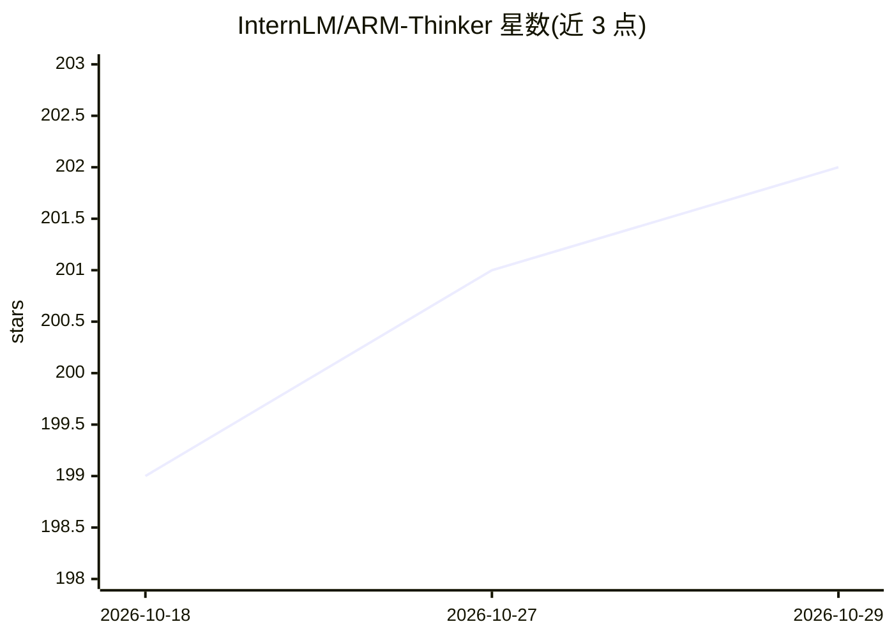

# InternLM/ARM-Thinker

⭐ 202 · Python · 推送 2026-10-13 · [GitHub](https://github.com/InternLM/ARM-Thinker) · 组织维护 · 中文 README

**科研者用的多模态生成式奖励模型：带工具调用的智能体推理与训练代码**

CVPR 2026 论文的官方代码仓库，实现 ARM-Thinker：一种结合智能体 Think–Act–Verify 循环的多模态奖励模型。推理时可自主调用图像裁剪缩放、文档检索、OCR 等外部工具，将返回证据纳入多模态上下文做出有据判断；训练路径为 SFT 冷启动加两阶段 GRPO。框架基于 Qwen2.5-VL-7B，agent 循环、工具模板与动作逻辑模块化，可在 verl 框架下增删工具，支持接入 VLMEvalKit 评测，并附带 ARMBench-VL 基准。代码与数据采用 CC BY-NC 4.0，仅限研究用途。

## 筛选速览

| 维度 | 判定 | 备注 |
|---|---|---|
| AI 角色 | `ai-ecosystem` | LLM/agent 周边工具 |
| 许可风险 | `none` | — |
| 部署形态 | `library` | 以包/库形式分发 |
| 模型依赖 | — | README 未给出锁定关系 |
| 硬件要求 | — | 无带数字的原话,不猜 |
| 安装摩擦 | `low` | 无编译、无系统依赖或容器化 |
| 成熟度 | — | 结构信号不足 |

## 能力要点

- Think–Act–Verify 智能体循环的推理与训练代码（arm_agent 模块）
- 两阶段 GRPO 强化学习分别优化工具选择与奖励准确性
- verl 框架下即插即用的工具实现（图像缩放、文档检索、OCR、web search 等）
- 附带 ARMBench-VL 基准与 VLMEvalKit 评测集成、轨迹可视化 notebook

## 适用场景

- 运行或修改带工具调用的多模态奖励模型 agent 循环
- 复现论文的 SFT 冷启动与 GRPO 训练流程
- 在 ARMBench-VL 上评测证据驱动的奖励模型

## 场景标签

`模型评测` `科研工具` `多模态` `强化学习` · 领域:评测与运维

## 证据(README 行号)

> L48: Current reward models suffer from **hallucination** and **weak visual grounding** due to their static, non-interact
> L61: We then apply a **two-stage GRPO** process: Stage 1 encourages **correct tool selection**, while Stage 2 refines **
> L141: ## ✒️ Citation

## 星数曲线

2026-10-18 199 → 2026-10-29 202（+3）

---
*卡片 v1 · prompt 1.4 · 生成 2026-10-22 · 置信度 high · 依据 README sha `ae02a6c92f0e` · [字段定义](../../DATASET.md)*
