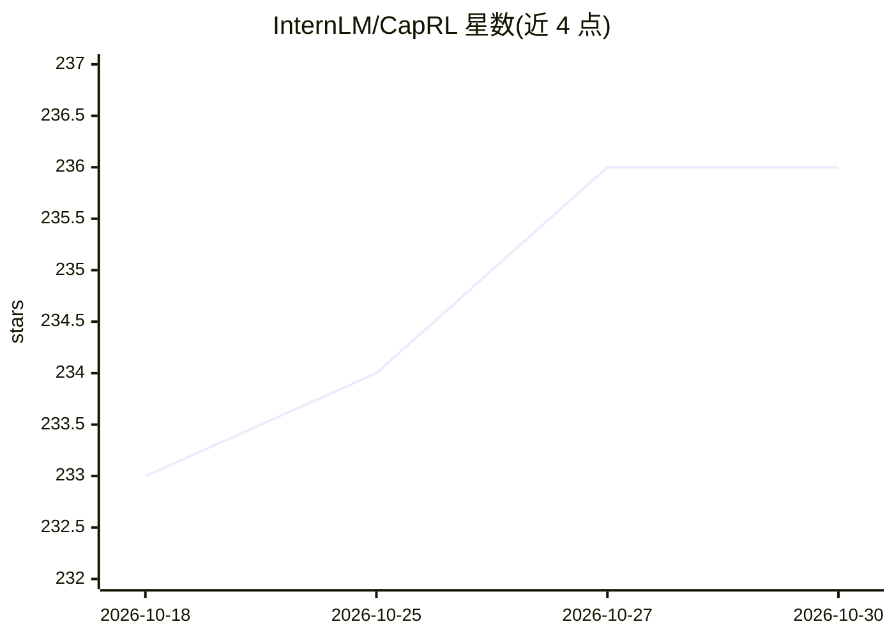

# InternLM/CapRL

⭐ 236 · Python · Apache-2.0 · 推送 2026-06-23 · [GitHub](https://github.com/InternLM/CapRL) · [官网](https://arxiv.org/pdf/2509.22647) · 组织维护 · 中文 README

**强化学习训练的密集图像/视频描述模型及训练代码（ICLR 2026）**

CapRL 是密集图像描述模型系列：以可验证奖励（QA 派生效用）做 RL 训练 LVLM 描述器，字幕质量由纯文本模型能否仅凭字幕回答视觉选择题来衡量。CapRL++ 扩展到视频，加入时间戳格式奖励与长度感知正则，基于 Qwen3-VL-4B 训练 CapRL-Video-4B。仓库提供模型（2B/3B/4B/8B 及 GGUF 量化版）、数据集（CapRL-2M、CapRL-Video-178K 等）、训练与评测代码（基于 OpenRLHF 与 verl），支持 vLLM 推理及 OpenAI 兼容 API 服务。需从源码安装，训练依赖 GPU 环境。

## 筛选速览

| 维度 | 判定 | 备注 |
|---|---|---|
| AI 角色 | `ai-native` | 本体是模型或模型工具 |
| 许可风险 | `permissive` | Apache-2.0 |
| 部署形态 | `library` | 以包/库形式分发 |
| 模型依赖 | local-ok | 支持本地模型 |
| 硬件要求 | — | 无带数字的原话,不猜 |
| 安装摩擦 | `low` | 无编译、无系统依赖或容器化 |
| 成熟度 | — | 结构信号不足 |

## 能力要点

- QA 效用可验证奖励的 RL 描述训练框架（图像与视频统一）
- CapRL-Video-4B 生成带时间戳的密集视频描述
- 提供 2B/3B/4B/8B 模型与 GGUF 量化版、多套数据集
- 支持 vLLM 部署为 OpenAI 兼容 API 服务

## 适用场景

- 为图像或视频生成密集结构化描述
- 用 RLVR 方法训练自己的描述模型
- 构建视频理解任务的带时间戳字幕数据集

## 场景标签

`多模态` `强化学习` · 领域:感知与多模态

## 证据(README 行号)

> L94: 🌈 We are excited to introduce the **CapRL series**, a family of dense captioning models trained with reinforcement 
> L96: The original **CapRL** framework focuses on dense image captioning. It optimizes an LVLM captioner with QA-derived 
> L110: - 🔥 **Strong temporal grounding**: CapRL-Video-4B generates explicit timestamped video descriptions and improves d

## 星数曲线

2026-10-18 233 → 2026-10-30 236（+3）

---
*卡片 v1 · prompt 1.4 · 生成 2026-10-22 · 置信度 high · 依据 README sha `27ffc6987ac5` · [字段定义](../../DATASET.md)*
