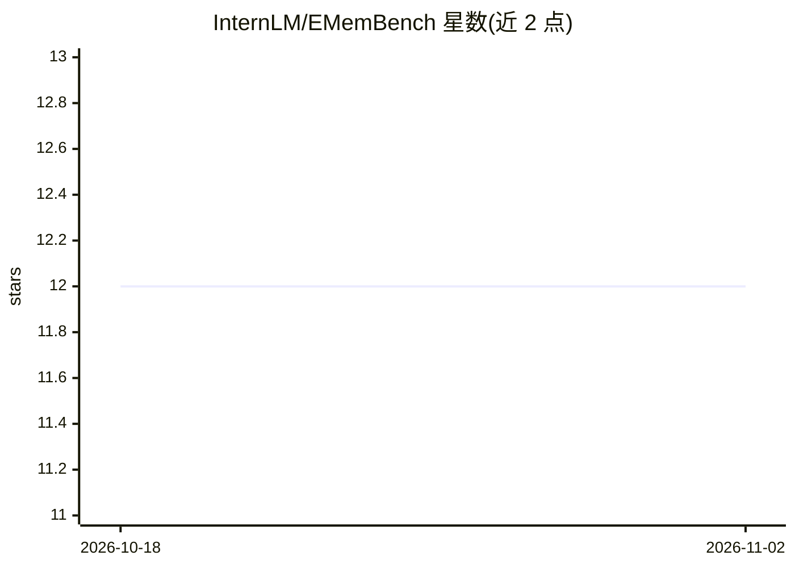

# InternLM/EMemBench

⭐ 12 · Python · Apache-2.0 · 推送 2026-03-05 · [GitHub](https://github.com/InternLM/EMemBench) · 组织维护 · 中文 README

**评测 VLM Agent 情景记忆的交互式基准生成框架**

EMNLP 2026 Findings 论文的官方代码库，提供评测交互式 Agent 情景（经验）记忆的程序化基准框架：不使用固定静态问答集，而是从 Agent 自身与游戏环境的交互轨迹生成问题，并由底层游戏信号计算可验证的答案。端到端流水线覆盖文本游戏 Jericho 与视觉游戏 Crafter：运行 Agent、记录轨迹、生成带真值的 QA、作答并评分；支持 Query Horizon Control 限制证据窗口。运行器假定 OpenAI 兼容聊天 API。许可证为 CC BY-NC 4.0，仅限研究用途。

## 筛选速览

| 维度 | 判定 | 备注 |
|---|---|---|
| AI 角色 | `ai-ecosystem` | LLM/agent 周边工具 |
| 许可风险 | `permissive` | Apache-2.0 |
| 部署形态 | `library` | 以包/库形式分发 |
| 模型依赖 | — | README 未给出锁定关系 |
| 硬件要求 | — | 无带数字的原话,不猜 |
| 安装摩擦 | `low` | 无编译、无系统依赖或容器化 |
| 成熟度 | — | 结构信号不足 |

## 能力要点

- 从 Agent 自身交互轨迹生成轨迹条件化 QA
- 由游戏信号/结构化日志程序化计算可验证真值
- Query Horizon Control 限制证据选择与答案计算的前缀窗口
- 覆盖 Jericho（文本）与 Crafter（视觉）两条端到端流水线

## 适用场景

- 评测我的 Agent 在交互环境中的情景记忆能力
- 为自研 Agent 生成带可验证真值的记忆问答数据
- 对比不同模型在变长情景下的记忆表现

## 场景标签

`模型评测` `Agent 记忆` · 领域:Agent 开发

## 证据(README 行号)

> L17: EMemBench is a **programmatic benchmark framework** for evaluating **episodic (experience-grounded) memory** in int
> L24: > EMemBench is not a single fixed dataset. It is a **benchmark generator + evaluation harness**: run an agent → log

## 星数曲线

2026-10-18 12 → 2026-11-02 12（+0）

---
*卡片 v1 · prompt 1.4 · 生成 2026-11-01 · 置信度 high · 依据 README sha `bea9aa44744b` · [字段定义](../../DATASET.md)*
