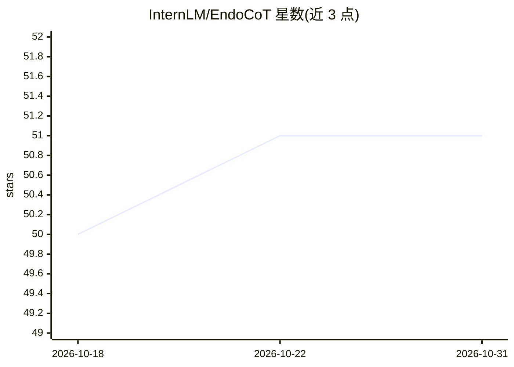

# InternLM/EndoCoT

⭐ 51 · Python · MIT · 推送 2026-08-11 · [GitHub](https://github.com/InternLM/EndoCoT) · [官网](https://internlm.github.io/EndoCoT/) · 组织维护 · 中文 README

**扩散模型内生思维链推理训练范式，用于复杂结构化生成**

ECCV 2026 论文 EndoCoT 的官方实现：在扩散模型中引入内生的链式推理（CoT），实现逐步推理生成，并输出透明的中间推理轨迹。基于 Qwen-Image-Edit 提供定制化 checkpoint，兼容 DiffSynth-Studio 训练流程；开放训练代码、训练数据与主任务 checkpoint（编辑模型 ckpt 尚未开源）。提供单例测试与评测脚本，训练采用两阶段脚本流程；隐空间推理步数目前需手动修改 pipeline 代码调整，作者计划后续优化。

## 筛选速览

| 维度 | 判定 | 备注 |
|---|---|---|
| AI 角色 | `ai-native` | 本体是模型或模型工具 |
| 许可风险 | `permissive` | MIT |
| 部署形态 | `None` |  |
| 模型依赖 | — | README 未给出锁定关系 |
| 硬件要求 | — | 无带数字的原话,不猜 |
| 安装摩擦 | `low` | 无编译、无系统依赖或容器化 |
| 成熟度 | `idea` | |

## 能力要点

- 扩散模型内生链式推理范式，逐步推理生成
- 提供透明可查的中间推理轨迹
- 开放训练代码、训练数据与主任务 checkpoint
- 基于 Qwen-Image-Edit，兼容 DiffSynth-Studio 训练

## 适用场景

- 在迷宫等结构化生成任务上运行/评测 EndoCoT checkpoint
- 用开放数据与两阶段脚本复现或续训模型
- 研究扩散模型中的链式推理机制

## 场景标签

`模型训练` `模型评测` · 领域:评测与运维

## 证据(README 行号)

> L25: - EndoCoT is a reasoning paradigm for diffusion models that enables step-by-step inference. It outperforms conventi
> L50:  > Following the configuration of ***Diffthinker***, we provide a customized checkpoint for **Qwen-Image-Edit**. Th
> L5: # EndoCoT: Scaling Endogenous Chain-of-Thought Reasoning in Diffusion Models

## 星数曲线

2026-10-18 50 → 2026-10-31 51（+1）

---
*卡片 v1 · prompt 1.4 · 生成 2026-10-24 · 置信度 high · 依据 README sha `4b9f7b8a8c4e` · [字段定义](../../DATASET.md)*
